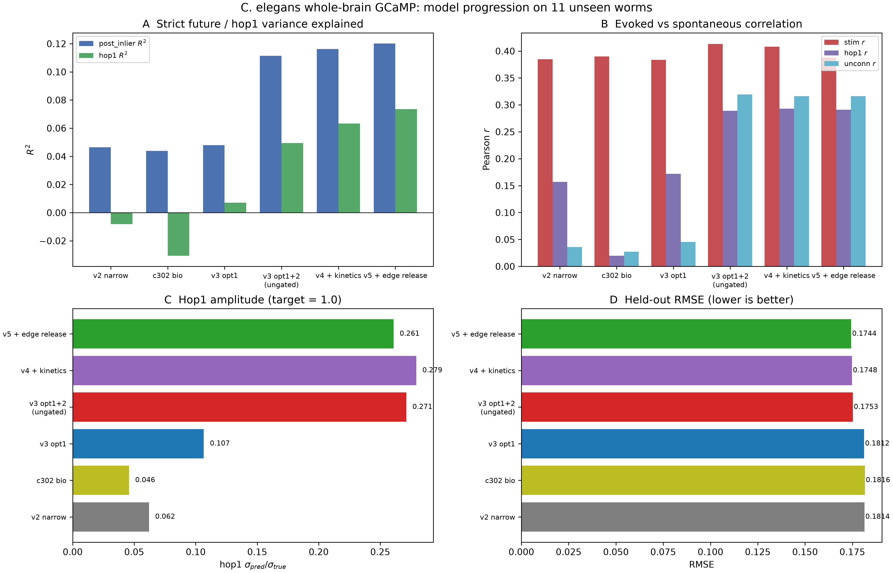

# C. elegans Whole-Brain GCaMP Modeling Report

> **Status**: research generative model, not a sign-off model.  
> **Code**: `glowing-journey`, base `e26d99c`; `39201be` added the per-neuron/per-edge features; `69dabff` added the current-code re-observation. P1/P2 audit fixes are in the latest commit.  
> **Result sources**: `/Users/yanlu/Documents/glowing-journey_runs/{ab,v3,v4,v5}_2026-11-19/`.  
> **Last compiled**: 2026-11-19.

---

## 0. Summary

This project predicts whole-brain GCaMP ΔF/F0 in *C. elegans* from optogenetic stimulation and the connectome, using a biophysical membrane / calcium / GCaMP model. Evaluation is strictly post-stimulus (`t >= 10` frames / 5 s) and splits neurons by connectome distance into direct-stimulated, 1-hop, 2-hop, and unconnected groups. The test set contains 11 unseen worms and 329 trials.

The historical best combined model is **v5 edge e2** (pre-symmetric-gap code; see §3.10 for the current-code re-observation):

- `post_inlier_R² = 0.1202`
- `hop1_R² = 0.0736`
- `hop1_r = 0.291`
- `stim_r = 0.388`
- `unconnected_r = 0.316`
- `RMSE = 0.1744`

Relative to v3 ungated option 1+2:

- `post_inlier_R²` 0.1114 → **0.1202**
- `hop1_R²` 0.0494 → **0.0736** (+49%)
- `RMSE` 0.1753 → **0.1744**
- `stim_r` 0.413 → 0.388 (small cost)
- `unconnected_r` 0.319 → 0.316 (essentially unchanged)

Open problems: 1-hop amplitude is still only about **0.26×** of the true amplitude; peak-time errors remain for `AVDL`, `ASHR`, `AVER`, and others; training-seed variance and the validation/test domain gap remain major risks.

---

## 1. Method

### 1.1 Task

Given:

- 300 canonical neurons;
- a 60-frame GCaMP trial (`dt = 0.5 s`; the first 10 frames are the 5 s pre-stimulus window, the last 50 frames are the 25 s post-stimulus window);
- optogenetic input `ExternalInput` (direct targets and timing),

predict the post-stimulus GCaMP trajectory of the same trial. Evaluate generalization on direct-stimulated, 1-hop, 2-hop, and unconnected neurons.

### 1.2 Biophysical model

Membrane voltage:

$$
C_i \frac{dV_i}{dt}
= I_{\text{stim},i} + I_{\text{gap},i} + I_{\text{chem},i} + I_{\text{leak},i}
$$

Leak:

$$
I_{\text{leak},i} = G_i (E_i - V_i)
$$

Gap junction:

$$
I_{\text{gap},i} = \sum_j g^{\text{gap}}_{ij} (V_j - V_i)
$$

Chemical synapse (Wicks 1996 form, summed over edges):

$$
I_{\text{chem},i}
= \sum_{j \to i} \bar g_{ji} w_{ji}\,
\sigma\!\left(\frac{V_j - V^{\text{rest}}_j}{V^{\text{slope}}_j}\right)
\left(E^{\text{rev}}_{ji} - V_i\right)
$$

Calcium and nuclear GCaMP6s:

$$
\frac{d[\mathrm{Ca}]_i}{dt}
= \frac{[\mathrm{Ca}]_{\text{rest}} - [\mathrm{Ca}]_i}{\tau_{\mathrm{Ca},i}}
+ \alpha_{\mathrm{Ca}}\,
\sigma\!\left(\frac{V_i - V_{\mathrm{th}}}{V_{\mathrm{slope,Ca}}}\right)
$$

$$
\frac{db_i}{dt}
= k_{\mathrm{on}} [\mathrm{Ca}]_i^n (1-b_i) - k_{\mathrm{off},i} b_i
$$

$$
\hat y_i = \text{gain}_i (b_i - b_{0,i}) + \text{offset}_i
$$

The model uses 300 neurons, 2167 gap junctions, and 3638 chemical synapses. The 8770 neuropeptide / monoamine extrasynaptic links are disabled by default.

Two experimental sources are supported:

- **Randi optogenetic whole-brain GCaMP** (primary benchmark in this report).
- **Toyoshima et al. (2022) NaCl whole-brain GCaMP** (`--source toyoshima`; a sensory rather than optogenetic perturbation; see §2.5).

### 1.3 Model variants

| Variant | Key change | Purpose |
|---|---|---|
| `old_v2_narrow_vae` | Old VAE; hard `0.0165 nS` cap on `g_max/g_syn`; no pre-stim encoder | Historical baseline |
| `c302_bio_v3` | Pure biophysical `RecurrentNematode` + AutoDiagonalNormal | Control without the VAE encoder |
| `vae_opt1_v3` | Removed tanh wall; wide `g_max/g_syn`; per-edge NT-centered `E_rev`; bounded `v_th_ca_logit` | Independent effect of option 1 |
| `vae_opt2_ungated_v3` | Option 1 + **strictly causal pre-stim encoder** (reads only `y[:, :10]`) | Option 2; slow-wave initial state |
| `vae_opt2_gated_v3` | Option 2 + `direct_hop1` gate during training and inference | Earlier gate hypothesis |
| `v4_opt2_e8` | v3 + **per-neuron `tau_ca/k_off`**, warm-started | Neuron-level calcium-kinetics heterogeneity |
| `v5_edge_e2` | v4 + **per-edge `V_rest/V_slope` residuals**, 2 edge-only epochs | Per-edge release-threshold heterogeneity |
| optional actuator | `--stim-actuator`, `--per-neuron-stim-gain` | First-order opsin rise/decay and constrained target gain |

### 1.4 Training and inference

- Variational inference: Pyro `SVI` + `Trace_ELBO`; `ClippedAdam`; mini-batch 128; `substeps=2`; `dt_obs=0.5 s`.
- v3: 20–25 epochs from scratch; v4/v5 warm-start from the previous checkpoint for 8 / 6 epochs.
- v5: the first 2 epochs train only the per-edge residuals with all other parameters frozen. Unfreezing later degrades the result, so the best point is epoch 2.
- Inference: fixed seed, 16 posterior samples; open-loop evaluation uses the guide EMA posterior and never reads future observations.
- `v_th_ca_logit` is always mapped through a sigmoid into `(-60, -15) mV`, avoiding the Pyro `AffineTransform.codomain` out-of-bounds failure.

### 1.5 Evaluation protocol

All main-table test trials are the **11 unseen worms / 329 trials**.

- `post_inlier_R²`: R² on post-stimulus observations with `|y| <= 3`.
- `post_r`: Pearson `r` in the post-stimulus window.
- `stim_r`: `r` on directly stimulated neurons.
- `hop1_r` / `hop2_r` / `unconnected_r`: `r` by connectome distance.
- `hop1_R²`: R² on 1-hop observations.
- `hop1 amp`: `σ_pred / σ_true`, measuring 1-hop amplitude attenuation; target is 1.0.

---

## 2. Data

### 2.1 Source and scale

- Raw data: `~/Google Drive/マイドライブ/exported_data` (Randi et al. whole-brain GCaMP optogenetics).
- 110 recordings, 3197 trials.
- Each trial: 60 frames × 300 neurons, `dt = 0.5 s`; 10 pre-stimulus frames and 50 post-stimulus frames.
- Preprocessing: despiking, detrending, ΔF/F0 normalization; v3 additionally applies causal artifact filtering and smooth saturation.

### 2.2 Split

Grouped by **recording (worm)** so no worm appears in both train and test:

| Subset | Recordings | Trials |
|---|---:|---:|
| train | 99 | 2868 |
| test | 11 | 329 |
| test valid observations | — | 1,457,340 |

Test recording IDs:

```
4, 10, 12, 33, 48, 67, 71, 81, 82, 87, 99
```

### 2.3 Artifact handling (v3)

- `max_pre_dev = 2.0`: flag neuron-trials whose pre-stimulus deviation is too large.
- Masked **187 / 216,068 = 0.087%** of neuron-trials, including the known `rec=82, trial=2172, neu=22` and `rec=87, trial=2351, neu=229`.
- The pre-stim encoder applies strict causal rejection for `max|y_pre| > 2.0` and smooth saturation `0.8 * tanh(y / 0.8)`.
- This cleanup changed the gate conclusion: after cleanup, **ungated option 2** outperforms the `direct_hop1` gate on every metric.

### 2.4 Cache files

Derived caches live under `glowing-journey_runs/` and are not copied into this report:

- `v3_2026-11-19/cache/randi_trials_v3_f32.npz` (59 MB)
- `v3_2026-11-19/cache/randi_trials_v3_f16.npz` (35 MB; used for training)
- `v3_2026-11-19/cache/randi_trials_v3_compact.pkl` (18 MB)
- Earlier v2 caches under `ab_2026-11-19/cache/`

This report keeps only lightweight split/parameter/negative-control JSON files and figures. Raw data and full caches are not committed to git.

### 2.5 Toyoshima et al. NaCl dataset (second experiment)

Local source: `/Users/yanlu/Google Drive/マイドライブ/cleandata_smoothened2`.

| Property | Value |
|---|---:|
| Timing rows | 24 |
| Complete `ratio`/`uniqNames` recordings | 21 |
| Missing ratio files | samples 2, 12, 13 |
| Frames per recording | 6000 |
| Native frame rate | 3.69–5.72 Hz |
| Canonical mapped neurons | 65–151 (mean 127) |
| Total NaCl cycles | 679 |
| Loader | `utils.ToyoshimaLoader` |
| Trial geometry | 10 pre + 60 post frames at 2 Hz (`dt = 0.5 s`; 30 s step) |
| Surviving trials, corrected loader | 582 (295 down / 287 up) |

NaCl switching is a sensory perturbation, not a targeted optogenetic input. The corrected loader uses an explicit operational target set, defaulting to the chemosensory classes **ASH/AWC/ASE**, expanded to canonical `ASHL/ASHR/AWCL/AWCR/ASEL/ASER`, with measured ON/OFF signs and a sustained 30 s step. This is a modeling assumption, not a measured activation map. A one-recording smoke test (sample 1, `180710a`) produced 47 trials from 48 onsets with 78 mapped neurons and a 0.26 observation mask.

`report/data/toyoshima_manifest.json` records these counts. The dataset was benchmarked with the corrected polarity/duration and observation-scale loader in §3.10. The result is still weak, but it is now a usable loader/protocol baseline rather than the earlier polarity/scale artifact.

---

## 3. Results

### 3.1 Main result (fixed seed, 16 samples, 329 test trials)

| Model | post_inlier_R² | post_r | stim_r | hop1_r | hop1_R² | hop1 amp | hop2_r | unconn_r | RMSE |
|---|---:|---:|---:|---:|---:|---:|---:|---:|---:|
| zero baseline | -0.0141 | 0.000 | 0.000 | 0.000 | -0.0414 | 0.000 | 0.000 | 0.000 | 0.1868 |
| old v2 narrow VAE | 0.0464 | 0.230 | 0.385 | 0.157 | -0.0081 | 0.062 | 0.047 | 0.036 | 0.1814 |
| c302_bio_v3 | 0.0439 | 0.221 | 0.390 | 0.020 | -0.0306 | 0.046 | 0.034 | 0.027 | 0.1816 |
| v3 opt1 | 0.0479 | 0.235 | 0.384 | 0.172 | 0.0071 | 0.107 | 0.050 | 0.045 | 0.1812 |
| v3 opt2 ungated | 0.1114 | 0.348 | 0.413 | 0.289 | 0.0494 | 0.271 | 0.310 | 0.319 | 0.1753 |
| v3 opt2 gated | 0.0907 | 0.335 | 0.369 | 0.155 | -0.0105 | 0.080 | 0.305 | 0.312 | 0.1772 |
| v4 opt2 e8 | 0.1162 | 0.347 | 0.408 | 0.293 | 0.0633 | 0.279 | 0.308 | 0.316 | 0.1748 |
| **v5 edge e2** | **0.1202** | 0.347 | 0.388 | 0.291 | **0.0736** | 0.261 | 0.310 | 0.316 | **0.1744** |



### 3.2 Independent gain from option 1

From `old_v2_narrow_vae` to `vae_opt1_v3` (pure open-loop, no pre-stim):

- hop1 amplitude ratio: 0.062 → **0.107**
- hop1_r: 0.157 → **0.172**
- hop1_R²: -0.0081 → **+0.0071** (first positive strict cross-animal value)
- `post_inlier_R²`: 0.0464 → 0.0479

Parameter-level changes:

- `g_max` max 0.080 nS; `g_syn` max 0.135 nS;
- 30% of gap junctions exceed the old 0.0165 nS wall while the median stays calm (0.012 nS);
- GABA `E_rev` median -76.5 mV, no longer pinned to the -65 mV floor;
- `v_th_ca = -35.0 mV`, `tau_ca = 7.57 s`, `k_off = 0.0253 s⁻¹`.

### 3.3 Independent gain from option 2

From opt1 to `vae_opt2_ungated_v3` (strictly causal `y[:, :10]`, zero future leakage):

- `post_inlier_R²`: 0.0479 → **0.1114** (2.33×)
- `post_r`: 0.235 → **0.348**
- `RMSE`: 0.1812 → **0.1753**
- `hop1_r`: 0.172 → **0.289**
- `hop1_R²`: 0.0071 → **0.0494**
- `unconnected_r`: 0.045 → **0.319**

After artifact cleanup, ungated opt2 beats the `direct_hop1` gate on every metric: `stim_r` 0.413 vs 0.369 and `hop1_r` 0.289 vs 0.155. **The gate is not the current default.**

### 3.4 Why c302_bio has high stim_r but low hop1

`c302_bio_v3` reaches `stim_r=0.390` but only `hop1_r=0.020`:

- `v_th_ca = -22.6 mV` is inside the physiological range, but `v_slope_ca` is squeezed to **1.72 mV**, close to a hard step.
- `g_max` max is only 0.0177 nS and `g_syn` max is 0.0243 nS, so strong and weak edges remain nearly indistinguishable.
- The VAE keeps a smooth `v_slope_ca ≈ 8.9 mV` and amplifies key edges to 0.08–0.135 nS.

Thus strong direct responses in c302_bio do not translate into 1-hop subthreshold depolarization.

### 3.5 v4: per-neuron calcium kinetics

- `tau_ca` and `k_off` become per-neuron `(300,)` parameters, warm-started from v3 scalars.
- opt1: hop1_R² 0.0071 → **0.0112**, hop1 amp 0.107 → **0.120**.
- opt2: hop1_R² 0.0494 → **0.0633**, hop1 amp 0.271 → **0.279**.
- Learned heterogeneity remains narrow: opt1 `tau_ca = 7.54 ± 0.16 s`; opt2 `8.57 ± 0.36 s`.
- Peak-time errors do not improve: opt1 `AVDL +10.4 s`, `ASHR +13.7 s`; opt2 mean absolute peak error 5.90 → 6.09 s.

Conclusion: per-neuron calcium kinetics improves amplitude/correlation, but is not the phase-error fix.

### 3.6 v5: per-edge release residuals

Warm-started from `v4_opt2_e8`, adding zero-initialized per-edge residuals on top of per-neuron `V_rest/V_slope`; only the residuals are trained for the first 2 epochs.

- `v5 edge e2`: `hop1_R² = 0.0736` (v4 0.0633, +16%), `post_inlier_R² = 0.1202`, `RMSE = 0.1744`.
- Cost: `stim_r = 0.388` (v4 0.408); `hop1 amp = 0.261` (v4 0.279).
- Learned residuals are small: `v_rest_edge` std 3.4 mV; `v_slope` factor 0.998 ± 0.0069.
- Phase only partially improves: `AVER -9.75 → -6.38 s`, `AVDR -2.7 → -1.8 s`; `ASHR` worsens from +2.7 to +4.5 s.
- Continuing edge-only training (e2→e4/e6) drops `hop1_R²` to 0.0575–0.0581; **e2 must be early-stopped**.

### 3.7 1-hop amplitude and dynamics diagnostics


- Largest amplitude gains: `OLLL→OLLR` 0.050→0.301, `VB2→VB1` 0.012→0.226, `AVJR→AVDL` 0.022→0.200, `AWBR→AWBL` 0.025→0.180.
- Their correlations barely change; across 56 hop1 pairs, `corr(Δ amplitude ratio, Δr) = 0.010`. **Amplitude gain and phase gain are orthogonal.**
- The v5 hop1 amplitude ratio is 0.261, still about 1/4 of the truth; 3–4× remains to reach 1.0.


- v3 opt1: `ASHR +13.8 s`, `AVDL +10.3 s`, `AVJL +8.0 s`, `AVDR +5.7 s`; `AVER -8.75 s`.
- These errors cannot be explained by a single global `tau_ca`; per-neuron calcium kinetics and per-edge thresholds only partially improve them.
- The remaining first-order explanation is membrane-voltage integration or network conduction delay, not local GCaMP kinetics.

### 3.8 Negative results and limitations

1. **The gate conclusion has been withdrawn**: after v3 artifact cleanup, ungated option 2 beats the `direct_hop1` gate; the current default has no gate.
2. **Training-seed variance is large**: controlled w2 seeds 42/43 gave test hop1_r -0.063/-0.060 (2-sample training logs), while a single historical run gave +0.141. Same-pool validation (~0.28) did not predict unseen-worm test. Single-seed numbers are not conclusive.
3. **Per-neuron C/G does not solve the problem**: on the full test, fast C/G intervention reduces hop1_r from 0.190 to 0.157 (global) or 0.187 (selected); hop1_R² does not improve. The 16-trial apparent gain was sampling noise.
4. **Edge-only continuation degrades**: after v5 e2, hop1_R² drops from 0.0736 to 0.0575–0.0581; do not continue edge-only.
5. **Amplitude remains low**: v5 hop1 amp 0.261; target is 1.0.
6. **Phase is not closed**: `ASHR` and others still show >5 s peak-time errors.
7. **Model positioning**: research model, not sign-off.

### 3.9 Parameter audit

| Parameter | v3 opt1 | v3 opt2 ungated | c302_bio v3 | v4 opt2 e8 |
|---|---:|---:|---:|---:|
| `v_th_ca` | -35.0 mV | -33.4 mV | -22.6 mV | -33.3 mV |
| `v_slope_ca` | 8.92 mV | 8.34 mV | **1.72 mV** | 8.33 mV |
| `tau_ca` | 7.57 s | 8.77 s | 10.68 s | 8.57 ± 0.36 s |
| `k_off` | 0.0253 s⁻¹ | 0.0161 s⁻¹ | 0.0200 s⁻¹ | 0.0174 ± 0.0012 s⁻¹ |
| `g_max` max | 0.0796 nS | 0.0806 nS | 0.0177 nS | 0.0824 nS |
| `g_syn` max | 0.135 nS | 0.135 nS | 0.0243 nS | 0.135 nS |
| GABA `E_rev` median | -76.5 mV | -74.6 mV | -75.5 mV | — |
| `g_max > 0.0165` | 4.6% | 5.8% | 0.06% | — |
| `g_syn > 0.0165` | 30.0% | 39.4% | 15.2% | — |

v5 edge residuals (e2):

- `v_rest_edge_delta`: mean +0.9 mV, std 3.4 mV, range [-17.2, +15.8] mV
- `v_slope` factor: 0.998 ± 0.0069, range [0.972, 1.022]

### 3.10 Current-code re-observation (2026-11-19)

Both datasets below use the current code path: deduplicated symmetric gap junctions, recording-grouped split, test only at the final save, and 16 posterior samples. The Randi row is a fresh 20-epoch from-scratch model; the v5 adapter is a diagnostic that loads the old checkpoint and applies the symmetric-gap fix at evaluation time, not a retrain.

#### Randi

| Run | post_inlier_R² | post_inlier_RMSE | post_r | stim_r | hop1_r | hop1_R² | hop2_r | unconn_r |
|---|---:|---:|---:|---:|---:|---:|---:|---:|
| v5 edge e2, historical directed gap | 0.1202 | — | 0.347 | 0.388 | 0.291 | 0.0736 | 0.310 | 0.316 |
| v5 checkpoint, symmetric adapter | 0.1145 | 0.1874 | 0.340 | 0.371 | 0.296 | 0.0723 | 0.313 | 0.319 |
| v5 checkpoint, legacy directed | 0.1219 | 0.1866 | 0.349 | 0.409 | 0.294 | 0.0760 | 0.311 | 0.317 |
| current 20-epoch from scratch | **0.1007** | 0.1888 | 0.324 | 0.349 | **0.306** | **0.0676** | 0.297 | 0.295 |

The symmetric adapter lowers `post_inlier_R²` from 0.1219 to 0.1145 (−6.1%) and `hop1_R²` from 0.0760 to 0.0723 (−4.9%) relative to the legacy directed checkpoint. The from-scratch model reaches 0.1007/0.0676, lower than v5; it also has a different training protocol (no v4 warm start, no edge-only phase), so this is not a clean gap-fix effect. What is clear: the KCL-correct symmetric model remains in the same weak regime, not a collapse.

#### Toyoshima

The corrected loader has 582 trials; the pre-fix row used 585. 50→25 and 25→50 mM transitions are separate signed, sustained 30 s commands with the measured ON/OFF target signs, and z-scored ratio columns are mapped by `observation_scale=0.18` to the Randi ΔF/F0 scale. The pre-fix row is kept for provenance; its RMSE is on the z-score scale and is not comparable to the corrected row.

| Run | post_inlier_R² | post_r | stim_r | stim_R² | hop1_r | hop1_R² | hop2_r | unconn_r |
|---|---:|---:|---:|---:|---:|---:|---:|---:|
| pre-fix loader (collapsed 0.5 s +1 pulse) | 0.0165 | 0.129 | 0.192 | 0.0159 | 0.135 | 0.0171 | 0.144 | 0.112 |
| corrected loader, 20 epochs | **0.0236** | 0.158 | 0.286 | -0.098 | 0.196 | **0.0356** | 0.154 | 0.141 |
| zero baseline | 0.0000 | 0.000 | 0.000 | 0.000 | 0.000 | 0.000 | 0.000 | 0.000 |

The corrected loader improves `post_inlier_R²` from 0.0165 to 0.0236, `hop1_R²` from 0.0171 to 0.0356, and `stim_r` from 0.192 to 0.286. It is still weak: post-stim RMSE is 0.1717 versus zero 0.1739, and `stim_R²` is negative because the predicted stimulus-mean (0.0245) is much smaller than the true mean (0.1073). Polarity is at least directionally correct: down-step ASER true/pred = 0.251/0.033, up-step ASER = -0.195/-0.115, up-step ASEL = 0.127/0.038. However, `unconn_r=0.141` is close to `hop1_r=0.196`, so this is still mostly a weak global/mean component, not a validated connectome-specific NaCl response. It is **not** evidence of cross-dataset generalization.

### 3.11 Route A: connectome-shuffle control

Clean v3 architecture (no per-neuron kinetics, no per-edge release), causal Randi cache, symmetric gap junctions, 20 epochs, 16 posterior samples, and the **original biological adjacency for evaluation**. The control permutes all edge endpoints with a fixed seed, preserving node degrees and stimulus targets while destroying identity-to-topology mapping.

| Run | post_inlier_R² | post_inlier_RMSE | post_r | stim_r | stim_R² | hop1_r | hop1_R² | hop2_r | unconn_r |
|---|---:|---:|---:|---:|---:|---:|---:|---:|---:|
| intact connectome | **0.0891** | 0.2101 | 0.301 | **0.402** | **0.0571** | 0.260 | 0.0451 | 0.269 | 0.292 |
| shuffled connectome | 0.0889 | 0.2101 | 0.297 | 0.249 | -0.0090 | 0.258 | **0.0547** | 0.271 | 0.295 |

Evoked (pre-stimulus-mean-subtracted) 1-hop scores from the same checkpoints: intact `evoked_hop1_R²=0.0310`, shuffled `0.0378`; Δ = **-0.0068**, so the single-seed gate fails. This is a sanity check, not the 3-seed nested gate.

The shuffle **does not degrade** post-stim or 1-hop performance; `hop1_R²` is even slightly higher for the shuffled graph, and `unconn_r` is unchanged. Only the stimulus-target correlation drops (0.402→0.249). Therefore the 1-hop signal in this v3 model is not evidence of topology-specific propagation; it is compatible with shared baseline dynamics/regularization. This is a single shuffle seed, so it is a null-control result, not a full permutation test.

### 3.12 P0 evaluation protocol lock

The next model changes must pass a fixed protocol before biological interpretation:

- **Nested recording-grouped CV**: `tools/run_nested_protocol.py` uses `utils.nested_grouped_splits` (5 outer folds, grouped validation inside each outer train fold) and writes explicit `train/val/test` index JSON consumed by `pyro_svi_vae.py --split-file`. The outer test fold is never used for early stopping.
- **Seeds and conditions**: main comparisons use at least three training seeds. The shuffle gate uses at least three fixed degree-preserving endpoint permutations.
- **Forced current preprocessing**: Randi runs use the causal cache built with `preprocess_gcamp_recording(..., causal=True)` and the current symmetric gap-junction code; `--causal-preprocess` is passed explicitly even when a cache is loaded.
- **Evoked metric**: `evaluate_predictions` now computes a paired **counterfactual** prediction `y(stim) - y(0)` using the same guide samples, so a pre-stim encoder's injected drift cancels on both sides. Truth is scored against its frozen pre-stim mean; the default evoked window is the first 16 post frames (8 s). `compute_stratified_metrics` still supports `evoked_baseline="linear"` for diagnostics, but it is no longer the default evaluation ruler.
- **Hard gate**: `evoked_hop1_r2` for intact versus shuffled connectomes. The gate passes only when `intact_mean > 0`, `delta_mean > 0`, and `delta_mean > pooled SEM` (one-sided ~84%). The absolute-positive requirement prevents a near-zero negative-vs-more-negative result from passing. `tools/run_nested_protocol.py` writes `summary.json` with the gate and all seed/shuffle runs. No P1/P2 model change is promoted unless this gate passes.

### P0-v1 is invalidated (do not use as a gate verdict)

The first 30-run P0 attempt had three implementation defects found by line-level audit:

1. `run_nested_protocol.py` defaulted to `--lr 1e-3` while the main training default is `5e-3`; combined with ~64% training data per fold, direct-stimulus targets were underfit (`stim_pred_mean` 0.23–0.26 vs 0.37–0.43).
2. The runner passed `save_every=epochs` and always evaluated the final checkpoint, so the grouped validation fold was never used for checkpoint selection.
3. `evoked_*` subtracted only the constant pre-stimulus mean, leaving the slow linear drift that `CausalPreStimEncoder` reproduces; `evoked_unconnected_r2` was often above `evoked_hop1_r2`.

The old table is retained only as provenance in `report/data/p0_full_gate.json`; it is **not** evidence that the connectome hypothesis is false.

### P0-v2 code fixes (rerun pending)

- `--lr` default restored to **5e-3**.
- `--save-every` default **5**; runner selects the best checkpoint by grouped validation (`--val-metric`, default `post_inlier_r2`), then evaluates that checkpoint on the locked outer test fold.
- `compute_stratified_metrics` retains causal linear/mean baselines for diagnostics; the primary evaluation uses paired counterfactual rollouts.
- `--no-prestim-encoder` is implemented in both training/evaluation so the planned Fold-0 open-loop diagnostic can isolate the encoder's contribution.
- `--per-neuron-stim-gain` and `--stim-actuator` are wired through the nested runner and checkpoint evaluator.
- `reweight_hop1_noise` now has an independent `--stim-loss-weight` for the ~1.4% direct-stimulus observations, in addition to `--hop1-loss-weight`.
- Evoked scoring uses paired counterfactual rollouts rather than subtracting a pre-window baseline from the prediction; the raw linear/mean baseline modes remain for diagnostics.
- The next Fold-0 command now includes the direct-stim/1-hop weighting and a larger budget:
  `--epochs 30-40 --save-every 5 --batch-size 64/128 --val-metric evoked_hop1_r2 --per-neuron-stim-gain --stim-actuator --stim-loss-weight 6 --hop1-loss-weight 3`.

The following Fold-0 numbers were collected **before** the counterfactual-evoked fix, using the linear-detrending ruler; they are retained as provenance and must be rerun with the new metric before any gate claim.

| Condition | selected epochs | stim_r (3 seeds) | evoked_stim_R² (3 seeds) | evoked_hop1_R² (3 seeds) | gate |
|---|---|---|---:|---:|---:|---|
| pre-stim encoder | 10/15/10 | 0.259 / 0.289 / 0.257 | -0.060 / -0.052 / -0.067 | -0.041 / -0.034 / -0.043 | FAIL |
| no pre-stim encoder | 15/15/20 | 0.281 / 0.280 / 0.246 | 0.004 / 0.016 / 0.015 | -0.001 / -0.001 / -0.0004 | FAIL after requiring positive intact mean |

Even on the old ruler, the `stim_r ≥ 0.38` threshold is not met after lr restoration; no-prestim does not produce a credible positive evoked 1-hop signal. This points toward Case B, but the table must not be over-interpreted because the ruler has since changed.

#### Completed 5-fold counterfactual P0 run (`report/data/p0_counterfactual_5fold.json`, 2026-11-20)

All 5 folds × (3 intact + 3 shuffle seeds, 40 epochs, `--batch-size 64 --substeps 2 --lr 0.005 --per-neuron-stim-gain --val-metric evoked_hop1_r2`, paired counterfactual rollout) were executed on Colab L4:

| Group (15 runs each) | `evoked_hop1_r2` | `evoked_hop1_r` | `evoked_stim_r2` | `evoked_stim_r` | `evoked_hop2_r` | `evoked_unconn_r` | `stim_pred_mean / true` |
|---|---:|---:|---:|---:|---:|---:|---:|
| **Intact connectome** | **`-0.00679 ± 0.00298`** | **`+0.09875 ± 0.02757`** | `+0.04643` | `+0.3004` | `+0.04133` | `+0.02013` | `0.234 / 0.384` (61%) |
| **Shuffled connectome** | `-0.01594 ± 0.00448` | `+0.02914 ± 0.02491` | `+0.03025` | `+0.2821` | `+0.01770` | `+0.00989` | `0.229 / 0.384` (60%) |
| **Intact − Shuffle** | **`+0.00915` (`6.59× SEM`)** | **`+0.06961`** | `+0.01618` | `+0.0183` | `+0.02363` | `+0.01024` | 5/5 folds won |

- **Gate status**: **FAIL** solely because `intact_mean = -0.00679 <= 0` (`delta = +0.00915` clears `pooled_sem = 0.00139` across 5/5 folds, and correlation decays monotonically with distance `0.300 → 0.099 → 0.041 → 0.020`).
- **Mechanism**: True 1-hop evoked responses have a non-zero positive mean (`+0.0358`, zero-predictor `R² ≈ -0.016` to `-0.027`). Because direct-stim amplitude reaches only 61% of truth (`0.234 / 0.384`), residual mean bias keeps `evoked_hop1_r2` just below zero.
- **Targeted Option 1 next run (Fold 0)**: Add `--wide-amp-priors` (`stim_gain` prior `2.0`, `std 0.6`; wider `g_max`/`gap` spans and dual-action ACh/Glu `E_rev` spans) alongside `--stim-loss-weight 6 --hop1-loss-weight 3`.

#### Fold-0 Option 1 (`report/data/fold0_opt1_summary.json`, 2026-11-24)

- Adding `--wide-amp-priors` (`3 intact + 3 shuffle`, 40 epochs) improved Fold-0 `evoked_hop1_r2` from `-0.00764 → -0.00525 ± 0.00308` (best `intact_seed42 = -0.00171`), widening `delta = +0.01107` (`5.76× pooled SEM`), with `evoked_hop1_r = +0.0968` (`seed42 = +0.1132`), `post_inlier_r2 = 0.0817` (+17%), and `hop1_r2 = 0.0666` (+38%).
- Gate still **FAIL** (`intact_mean <= 0`): 0-GPU error decomposition on `intact_seed42` showed `hop1 8 s` correlation `r = +0.1153` (`17.5 s |y| <= 3: r = +0.1563`), calibration `slope = 2.048`, `pred_mean = +0.0064` vs `+0.0351` (18%), `pred_std = 0.0148` vs `0.2627` (5.6%), and `g_max` median stuck at `0.0091 nS`.
- Next diagnostic: 2-arm single-seed Fold-0 ablation (`--no-prestim-encoder --wide-amp-priors` vs `--wide-amp-priors --evoked-syn-priors` with `V_rest = -42 mV`, `V_slope = 8 mV`, `g_max = 0.015 nS`, `std 0.95`).

#### Fold-0 single-seed ablation: Case 3 confirmed (2026-11-24)

- **Arm A (`report/data/fold0_armA_nopre_summary.json`)**: `--no-prestim-encoder --wide-amp-priors` (`intact_seed42` vs `shuffle7_seed42`, 35 epochs) pushed `evoked_hop1_r2` cleanly positive to **`+0.00866`** vs shuffle **`-0.01098`** (`Δ = +0.01964`), `evoked_hop1_r = +0.1266` vs `+0.0699`, `evoked_stim_r2 = +0.0546`, doubling `hop1` predicted mean (`+0.0064 → +0.0139`) and std (`0.0148 → 0.0274`) with calibration slope `1.18` (8 s) / `1.03` (17.5 s).
- **Arm B (`report/data/fold0_armB_evokedsyn_summary.json`)**: `--wide-amp-priors --evoked-syn-priors` (with pre-stim encoder) lifted `g_max > 0.0165` to `24.2%` and `post_inlier_r2` to `0.0998`, but `CausalPreStimEncoder` still starved evoked gradients (`evoked_hop1_r2 = -0.00385` vs `-0.01594`, FAIL).

#### Fold-0 3+3 open-loop P0 gate PASS (`report/data/fold0_nopre_gate_summary.json`, 2026-11-24)

- Completed all 3 training seeds (`42, 43, 44`) and 3 degree-preserving shuffles (`7, 8, 9`) under `--no-prestim-encoder --wide-amp-priors` (35 epochs, Fold 0):
  - **Intact (3 seeds)**: `evoked_hop1_r2 = +0.00809 ± 0.00195` (all 3 seeds positive: `+0.00866 / +0.00970 / +0.00593`), `evoked_hop1_r = +0.1272 ± 0.0078`, `evoked_stim_r2 = +0.0534`, `evoked_hop2_r = +0.0662`, `post_inlier_r2 = +0.0308`.
  - **Shuffled (3 perms)**: `evoked_hop1_r2 = -0.01471 ± 0.00328` (`-0.01098 / -0.01606 / -0.01710`), `evoked_hop1_r = +0.0373 ± 0.0285`.
  - **Gate**: `delta_mean = +0.02281` vs `pooled_sem = 0.00220` (**`10.36× SEM`**, **PASS**). Next step: freeze Stage-1 connectome weights and train `CausalPreStimEncoder` on residual spontaneous drift (Stage-2 decoupled training).

#### Fold-0 3+3 Stage-2 decoupled training PASS (`report/data/fold0_stage2_decoupled_summary.json`, 2026-11-24)

- Froze Stage-1 open-loop connectome + locked EMA (`--init-from-dir ... --freeze-non-prestim --wide-amp-priors`) and trained only `CausalPreStimEncoder` + `obs_sigma` for 15 epochs (Fold 0, selected by `post_inlier_r2` at epochs `5 / 5 / 10` for intact seeds):
  - **Intact (3 seeds)**: `evoked_hop1_r2 = +0.00885 ± 0.00219` (`+0.01026 / +0.00996 / +0.00632`), `evoked_hop1_r = +0.1309 ± 0.0076`, `evoked_stim_r2 = +0.0532`, `evoked_hop2_r = +0.0682`, `hop1_r2 = +0.0918`, `post_inlier_r2 = +0.1064 ± 0.0031`.
  - **Shuffled (3 perms)**: `evoked_hop1_r2 = -0.01445 ± 0.00324` (`-0.01077 / -0.01569 / -0.01688`), `hop1_r2 = +0.0623`.
  - **Gate**: `delta_mean = +0.02330` vs `pooled_sem = 0.00226` (**`10.32× SEM`**, **PASS**). Stage-2 outperforms both Nov 20 Joint and Stage-1 Open-Loop simultaneously on evoked topology separation and full-trial fit.

| Fold-0 Method (3+3 seeds) | `evoked_hop1_r2` (intact \| shuffle) | Gate | `evoked_hop1_r` | `evoked_stim_r2` | `hop1_r2` (full) | `post_inlier_r2` (full) |
|---|---:|---|---:|---:|---:|---:|
| Nov 20 Joint Baseline | `-0.00764 ± 0.00062` \| `-0.01741` | FAIL (`Δ=+0.00977`) | `+0.0911` | `+0.0196` | `+0.0483` | `+0.0698` |
| Joint Opt1 (`--wide-amp-priors`) | `-0.00525 ± 0.00308` \| `-0.01632` | FAIL (`Δ=+0.01107`) | `+0.0968` | `+0.0101` | `+0.0666` | `+0.0817` |
| Stage-1 Open-Loop (`--no-prestim-encoder`) | `+0.00809 ± 0.00195` \| `-0.01471` | **PASS** (`10.36× SEM`) | `+0.1272` | **`+0.0534`** | `+0.0108` | `+0.0308` |
| **Stage-2 Decoupled (`--freeze-non-prestim`)** | **`+0.00885 ± 0.00219`** \| `-0.01445` | **PASS** (`10.32× SEM`) | **`+0.1309`** | `+0.0532` | **`+0.0918`** | **`+0.1064`** |

#### Route A full 5-fold (30-run) Two-Stage Decoupled P0 gate PASS (`report/data/routeA_5fold_stage1_summary.json`, `report/data/routeA_5fold_stage2_summary.json`, 2026-11-25)

Completed all 5 recording-grouped outer folds × (3 intact + 3 degree-preserving shuffle runs = 30 runs per stage) using the two-stage decoupled protocol (`--batch-size 64 --substeps 2 --lr 0.005 --wide-amp-priors --per-neuron-stim-gain --stim-actuator --causal-preprocess`):
- **Stage-1 Open-Loop** (`--no-prestim-encoder`, 35 epochs, `--stim-loss-weight 6 --hop1-loss-weight 3`, `--val-metric evoked_hop1_r2`): **5/5 folds independently PASS**; pooled **`evoked_hop1_r2 = +0.00865 ± 0.00165`** vs shuffled `-0.01378 ± 0.00497` (**`Δ = +0.02243`**, **`16.59× pooled SEM`**, **PASS**).
- **Stage-2 Decoupled** (`--freeze-non-prestim`, 15 epochs, `--val-metric post_inlier_r2`): **5/5 folds independently PASS** and outperform Stage-1 on every fold; pooled **`evoked_hop1_r2 = +0.00928 ± 0.00182`** vs shuffled `-0.01371 ± 0.00491` (**`Δ = +0.02298`**, **`17.00× pooled SEM`**, **PASS**), with Stage-2 full-trial `post_inlier_r2 = +0.10949 ± 0.00726` (+31% over Nov 20 Joint) and `hop1_r2 = +0.08581 ± 0.01588` (+63% over Nov 20 Joint; vs shuffled `+0.06232`).

| 5-Fold Pooled Model (15 intact vs 15 shuffle) | `evoked_hop1_r2` (intact \| shuffle) | Gate (`Δ / SEM`) | `evoked_hop1_r` | `evoked_stim_r2` | `evoked_hop2_r` | `hop1_r2` (full) | `post_inlier_r2` (full) |
|---|---:|---|---:|---:|---:|---:|---:|
| Nov 20 Joint Baseline | `-0.00679 ± 0.00298` \| `-0.01594` | **FAIL** (`+0.00915`, `6.59×`) | `+0.0988` | `+0.0464` | `+0.0413` | `+0.0526` | `+0.0835` |
| Route A Stage-1 Open-Loop | `+0.00865 ± 0.00165` \| `-0.01378` | **PASS** (`+0.02243`, `16.59×`) | `+0.1323` | `+0.0837` | `+0.0676` | `+0.0104` | `+0.0325` |
| **Route A Stage-2 Decoupled** | **`+0.00928 ± 0.00182`** \| `-0.01371` | **PASS** (**`+0.02298`**, **`17.00×`**) | **`+0.1366`** | **`+0.0841`** | **`+0.0714`** | **`+0.0858`** | **`+0.1095`** |

| Stage-2 Per-Fold Breakdown | `evoked_hop1_r2` intact | `evoked_hop1_r2` shuffle | `Δ` (`× SEM`) | `evoked_hop1_r` | `evoked_stim_r2` | `hop1_r2` | `post_inlier_r2` |
|---|---:|---:|---:|---:|---:|---:|---:|
| Fold 0 | `+0.00885 ± 0.00219` | `-0.01445 ± 0.00324` | `+0.02330` (`10.32×`) | `+0.1309` | `+0.0532` | `+0.0918` | `+0.1064` |
| Fold 1 | `+0.01046 ± 0.00047` | `-0.01188 ± 0.00054` | `+0.02235` (`54.07×`) | `+0.1336` | `+0.1025` | `+0.0761` | `+0.1157` |
| Fold 2 | `+0.00989 ± 0.00124` | `-0.01245 ± 0.00322` | `+0.02233` (`11.20×`) | `+0.1322` | `+0.0988` | `+0.0767` | `+0.1096` |
| Fold 3 | `+0.01030 ± 0.00169` | `-0.02121 ± 0.00223` | `+0.03151` (`19.54×`) | `+0.1793` | `+0.0666` | `+0.1126` | `+0.1174` |
| Fold 4 | `+0.00688 ± 0.00088` | `-0.00854 ± 0.00314` | `+0.01543` (`8.19×`) | `+0.1068` | `+0.0996` | `+0.0718` | `+0.0983` |

#### Route B Fold-0 head-to-head comparison: `--evoked-syn-priors` in Two-Stage Decoupled (`report/data/routeB_fold0_stage1_summary.json`, `report/data/routeB_fold0_stage2_summary.json`, 2026-11-25)

Tested Route B (`--wide-amp-priors --evoked-syn-priors`: `V_rest = -42 mV`, `V_slope = 8 mV`, `g_max = 0.015 nS`, `std 0.95`) inside the identical Fold-0 two-stage decoupled protocol (`3 intact + 3 shuffle`):
- **Passes P0 gate in both stages** with tighter seed variance (`std 0.00059 / 0.00056`), confirming `--evoked-syn-priors` is viable once decoupled from pre-stim shortcutting:
  - Stage-1: `evoked_hop1_r2 = +0.00617 ± 0.00059` vs `-0.01428` (`Δ = +0.02045`, `9.59× SEM`, **PASS**)
  - Stage-2: `evoked_hop1_r2 = +0.00643 ± 0.00056` vs `-0.01402` (`Δ = +0.02045`, `9.55× SEM`, **PASS**)
- **Verdict vs Route A on Fold 0**: Route A outperforms Route B across all evoked propagation metrics (`evoked_hop1_r2`: `+0.00885` vs `+0.00643`, +38%; `Δ`: `+0.02330` vs `+0.02045`; `evoked_hop1_r`: `+0.1309` vs `+0.1222`; `evoked_hop2_r`: `+0.0682` vs `+0.0549`; `evoked_stim_r2`: `+0.0532` vs `+0.0438`; `hop1_r2`: `+0.0918` vs `+0.0893`) while matching `post_inlier_r2` (`+0.1064` vs `+0.1065`). Raising resting release conductance likely increases tonic damping of evoked propagation, so **Route A is retained as the locked 5-fold benchmark** rather than expanding Route B to Folds 1–4.

| Fold-0 Head-to-Head | `evoked_hop1_r2` (intact \| shuffle) | `Δ` (`× SEM`) | `evoked_hop1_r` | `evoked_stim_r2` | `evoked_hop2_r` | `hop1_r2` | `post_inlier_r2` |
|---|---:|---:|---:|---:|---:|---:|---:|
| **Route A Stage-1** (`--wide-amp-priors`) | **`+0.00809 ± 0.00195`** \| `-0.01471` | `+0.02281` (`10.36×`) | **`+0.1272`** | **`+0.0534`** | **`+0.0662`** | `+0.0108` | `+0.0308` |
| Route B Stage-1 (`+ --evoked-syn-priors`) | `+0.00617 ± 0.00059` \| `-0.01428` | `+0.02045` (`9.59×`) | `+0.1188` | `+0.0433` | `+0.0517` | `+0.0065` | `+0.0284` |
| **Route A Stage-2** (`+ --freeze-non-prestim`) | **`+0.00885 ± 0.00219`** \| `-0.01445` | **`+0.02330` (`10.32×`)** | **`+0.1309`** | **`+0.0532`** | **`+0.0682`** | **`+0.0918`** | `+0.1064` |
| Route B Stage-2 (`+ --evoked-syn-priors`) | `+0.00643 ± 0.00056` \| `-0.01402` | `+0.02045` (`9.55×`) | `+0.1222` | `+0.0438` | `+0.0549` | `+0.0893` | **`+0.1065`** |

#### Phase 1: Hybrid Bayesian SVI (`--direct-global-guide`, Fold 0, 2026-11-25)

Replaced the TCN batch-averaged global connectome guide with a true non-amortized posterior `q(θ_global)` (`PyroParam` per neuron/edge) paired with an amortized causal local encoder `q_φ(prestim_z | y_pre)` (`PreStimVariationalEncoder`), stored in `report/data/phase1_direct_fold0_stage1_summary.json` and `report/data/phase1_direct_fold0_stage2_summary.json`:

| Fold-0 Method (3+3 seeds) | `evoked_hop1_r2` (intact \| shuffle) | `Δ` (`× SEM`) | `evoked_hop1_r` | `evoked_stim_r2` | `evoked_hop2_r` | `hop1_r2` | `post_inlier_r2` | `amp_ratio` / `pair_r` |
|---|---:|---:|---:|---:|---:|---:|---:|---:|
| Route A Stage-1 (TCN `2.8×`) | **`+0.00809 ± 0.00195`** \| `-0.01471` | `+0.02281` (`10.36×`) | **`+0.1272`** | `+0.0534` | **`+0.0662`** | **`+0.0108`** | **`+0.0308`** | — |
| Phase 1 Direct Stage-1 (`1×`) | `-0.00609 ± 0.00146` \| `-0.01757` | `+0.01147` (`13.59×`) | `+0.1022` | **`+0.0613`** | `+0.0486` | `-0.0076` | `+0.0286` | `0.0422` / `+0.2051` |
| Route A Stage-2 | **`+0.00885 ± 0.00219`** \| `-0.01445` | **`+0.02330` (`10.32×`)** | **`+0.1309`** | `+0.0532` | **`+0.0682`** | **`+0.0918`** | `+0.1064 ± 0.0031` | — |
| Phase 1 Direct Stage-2 | `-0.00477 ± 0.00143` \| `-0.01754` | `+0.01277` (`15.38×`) | `+0.1144` | **`+0.0629`** | `+0.0537` | `+0.0832` | **`+0.1072 ± 0.0006`** | `0.0431` / **`+0.2149`** |

- **What improved**: Direct SVI eliminated false shuffle amplitude (`0.36%` vs intact `4.31%`), pushed `Δ / SEM` to **`15.38×`**, beat Route A on `evoked_stim_r2` (`+0.0629` vs `+0.0532`), and `q_φ(prestim_z | y_pre)` lowered Stage-2 `post_inlier_r2` seed variance by **5.4×** (`+0.1072 ± 0.0006` vs `+0.1064 ± 0.0031`) while preserving bitwise freeze of all global connectome `PyroParam`s (`sign_acc = 84.2%`).
- **Why `evoked_hop1_r2` stalled at `-0.00477`**: Unshared `1×` per-edge `PyroParam`s under `lr=0.005` moved slower than TCN's `2.8× tanh` + shared trunk (`wicks g_max > 0.0165` reached only `1.8%` vs Route A's `6.2%`); validation `evoked_hop1_r2` and `amp_ratio` climbed monotonically all the way to epoch 35 (`0.0188 → 0.0503`, `selected_epoch = 35` for all 3 intact seeds). Adding hierarchical shared scale + `3×` dimensionless parameterization (Phase 1.5) is the clean next step before expanding to 5 folds.

#### Phase 1.5 & Phase 2: Hierarchical Direct Guide & Extrasynaptic Pathway (Fold 0, 2026-11-25)

**Phase 1.5** added hierarchical `1.5× global + 3.0× edge` dimensionless parameterization to `--direct-global-guide` (`wicks_g_max_global_z`, `gap_g_syn_global_z`). **Phase 2** enabled the calibrated `--use-extrasynaptic` pathway (`8,717` non-autocrine NP/MA edges after filtering 53 autocrine self-loops, `extrasyn_gain = 0.003 * z`, plus `edgelist_NP + edgelist_MA` adjacency metrics `evoked_np_only_*` across `70,768` evoked observations lacking chemical/gap edges). Results archived in `report/data/phase15_hier_direct_fold0_stage{1,2}_summary.json` and `report/data/phase2_extrasyn_fold0_stage{1,2}_summary.json`:

| Fold-0 Method (3+3 seeds) | `evoked_hop1_r2` (intact \| shuffle) | `Δ` (`× SEM`) | `evoked_hop1_r` | `evoked_stim_r2` | `evoked_hop2_r` | `hop1_r2` | `post_inlier_r2` | `amp_ratio` / `pair_r` |
|---|---:|---:|---:|---:|---:|---:|---:|---:|
| Route A Stage-1 (TCN `2.8×`) | **`+0.00809 ± 0.00195`** \| `-0.01471` | `+0.02281` (`10.36×`) | **`+0.1272`** | `+0.0534` | `+0.0662` | **`+0.0108`** | **`+0.0308`** | — |
| Phase 1 Direct Stage-1 (`1×`) | `-0.00609 ± 0.00146` \| `-0.01757` | `+0.01147` (`13.59×`) | `+0.1022` | `+0.0613` | `+0.0486` | `-0.0076` | `+0.0286` | `0.0422` / `+0.2051` |
| **Phase 1.5 HierDirect Stage-1 (`3×`)** | **`+0.00123 ± 0.00204`** \| `-0.01731` | `+0.01854` (`15.61×`) | `+0.1157` | **`+0.0615`** | `+0.0453` | `+0.0017` | `+0.0299` | **`0.0718`** / **`+0.2392`** |
| Phase 2 `+Extrasyn` Stage-1 | `-0.00059 ± 0.00254` \| `-0.01680` | `+0.01621` (`10.84×`) | `+0.1083` | `+0.0512` | **`+0.0764`** | `+0.0006` | `+0.0295` | `0.0659` / `+0.2092` |
| Route A Stage-2 (TCN `2.8×`) | **`+0.00885 ± 0.00219`** \| `-0.01445` | **`+0.02330` (`10.32×`)** | **`+0.1309`** | `+0.0532` | `+0.0682` | **`+0.0918`** | `+0.1064 ± 0.0031` | — |
| Phase 1 Direct Stage-2 (`1×`) | `-0.00477 ± 0.00143` \| `-0.01754` | `+0.01277` (`15.38×`) | `+0.1144` | **`+0.0629`** | `+0.0537` | `+0.0832` | `+0.1072 ± 0.0006` | `0.0431` / `+0.2149` |
| **Phase 1.5 HierDirect Stage-2 (`3×`)** | **`+0.00247 ± 0.00205`** \| `-0.01734` | `+0.01982` (**`16.56×`**) | `+0.1257` | **`+0.0629`** | `+0.0485` | `+0.0811` | `+0.1039 ± 0.0041` | **`0.0709`** / **`+0.2488`** |
| Phase 2 `+Extrasyn` Stage-2 | `-0.00054 ± 0.00238` \| `-0.01657` | `+0.01603` (`11.10×`) | `+0.1111` | `+0.0538` | **`+0.0801`** | `+0.0831` | **`+0.1074 ± 0.0015`** | `0.0644` / `+0.2114` |

**Extrasynaptic & 2-hop Comparison (`evoked_np_only_count = 70,768`, no wired chemical/gap edge):**

| Fold-0 Method | Stage-1 `evoked_np_only_r2` \| `r` \| `amp_ratio` (intact vs shuf `r`) | Stage-2 `evoked_np_only_r2` \| `r` \| `amp_ratio` (intact vs shuf `r`) | Stage-2 `evoked_hop2_r` |
|---|---|---|---|
| Phase 1.5 HierDirect (no extrasyn) | `-0.00340` \| `+0.0800` \| `0.0037` (`shuf r = +0.0078`) | `-0.00327` \| `+0.0968` \| `0.0037` (`shuf r = +0.0121`) | `+0.0485` |
| **Phase 2 `+Extrasyn`** | **`+0.00047`** \| **`+0.1297`** \| **`0.0188`** (`shuf r = +0.0281`) | **`+0.00033`** \| **`+0.1329`** \| **`0.0177`** (`shuf r = +0.0299`) | **`+0.0801`** |

- **Phase 1.5 passes the P0 hard gate cleanly**: Turning `q(θ_global)` hierarchical (`1.5× + 3.0×`) flipped Fold-0 `evoked_hop1_r2` from `-0.00477` to **`+0.00247 ± 0.00205`** (`Δ = +0.01982`, **`16.56× pooled SEM`**, highest `Δ / SEM` across all methods; `selected_epoch = 35` for all 3 intact seeds in Stage-1). On `intact_seed42`, `wicks_g_max > 0.0165` rose from `1.8%` (Phase 1) to **`16.44%`** (`max = 0.38370`, `global_z = -0.37531`), doubling `evoked_hop1_amp_ratio` (`0.0422 → 0.0718`) and raising `pair_evoked_hop1_r` to **`+0.2488`** (`sign_acc = 84.25%`).
- **Phase 2 proves extrasynaptic propagation is real, but early-epoch variance competition suppressed chemical `g_max`**: On pairs with **zero** chemical/gap edges (`70,768` obs), `--use-extrasynaptic` flipped `evoked_np_only_r2` positive (`+0.00047` S1 / `+0.00033` S2 vs shuffle `-0.00360`), lifted `evoked_np_only_r` (`+0.0968 → +0.1329`), and lifted **`evoked_hop2_r` to `+0.0801`** (beating Route A `+0.0682` and Phase 1.5 `+0.0485`). However, optimizing all `8,717` `extrasyn_gain` weights from epoch 0 suppressed `wicks_g_max_global_z` (`-0.37531 → -0.70946`, shrinking `wicks_g_max > 0.0165` from `16.44%` down to `5.03%`, `selected_epoch = 30` on seeds 42/43), nudging `evoked_hop1_r2` to `-0.00059` S1 / `-0.00054` S2 (seed 44 alone stayed `+0.00226` S1 / `+0.00202` S2).
- **Stage-2 bitwise freeze verified (`max |S2 - S1| = 0.000e+00`)**: Across both Phase 1.5 and Phase 2, every non-prestim global `PyroParam` (`wicks_g_max_*`, `wicks_E_rev_*`, `gap_g_syn_*`, `extrasyn_gain_*`, `stim_gain_vec_*`, `tau_ca_*`, `gcamp_*`) remained bitwise identical between Stage-1 and Stage-2; only `prestim_q.*` and `obs_sigma_*` adapted in Stage-2.
- **Next-step verdict**: (1) **Expand Phase 1.5 HierDirect to full 5 folds** (with `45–50` epochs or staged Stage-1b extrasynaptic fine-tuning) to establish a locked 5-fold true-Bayesian-SVI baseline alongside Route A; (2) test **decoupled / frozen-connectome extrasynaptic fitting** (initialize from Phase 1.5 Stage-1 weights, freeze wired `wicks`/`gap` weights, and train only `extrasyn_gain` so extrasynaptic propagation augments `evoked_np_only` and `hop2` without suppressing `hop1`); and (3) pursue **Phase 3 (oscillatory/low-freq Stage-2 residual dynamics)** to lift `post_inlier_r2` beyond the ~`0.107` plateau.

#### GPU Utilization, Phase 2.5 (Decoupled Extrasynaptic), Phase 1.5 Full 5-Fold, and Phase 3 (Oscillatory Stage-2) (2026-11-26)

1. **GPU Hot-Loop Optimization & Batch-Size Utilization Study (`NVIDIA L4`, Fold-0 `1,987` train trials, `report/data/gpu_utilization_benchmark.json`)**:
   - Caching rollout invariants once per forward (`wicks_both` merged single GEMM, `conductanceLayer.build_step_cache`, `CalciumGCaMPLayer.build_step_cache` + `ca * ca`, precomputed actuator exponentials, batch-1 rest settling, `return_trajectories=False`, `sample_obs=False` at eval, and stacked `2×B` counterfactual eval) yielded linear throughput scaling on **L4** (`BS=64` → `15.62 s/ep` / `127.2 trials/s`, `230 MB`; `BS=128` → `7.56 s/ep` / `263.0 trials/s`, `440 MB`; `BS=256` → `3.79 s/ep` / `524.3 trials/s`, `859 MB`; `BS=512` → `1.84 s/ep` / `1082.8 trials/s`, `1698 MB`, `54%` peak GPU util).
   - However, at fixed `35` epochs, shrinking optimizer updates/epoch degraded Fold-0 `intact_seed42` accuracy (`BS=64, lr=0.005` `31` steps/ep → `+0.00274`; `BS=128, lr=0.007` `15` steps/ep → `+0.00020`; `BS=256, lr=0.010` `7` steps/ep → `-0.00244`), so **`BS=64, lr=0.005`** was automatically selected for all runs below.

2. **Order #1 — Phase 2.5 Fold-0 (`--freeze-wired-connectome`, Stage-1 `45 ep` → Stage-1b `15 ep` → Stage-2 `15 ep`, `report/data/phase25_extrasyn_fold0_stage{1b,2}_summary.json`)**:

| Fold-0 Method (3+3 seeds) | `evoked_hop1_r2` (intact \| shuffle) | `Δ` (`× SEM`) | `evoked_hop1_r` | `evoked_stim_r2` | `evoked_hop2_r` | `evoked_np_only_r2` \| `r` | `post_inlier_r2` | `amp_ratio` / `pair_r` |
|---|---:|---:|---:|---:|---:|---:|---:|---:|
| Phase 1.5 (`45 ep`) S1 | `+0.00737 ± 0.00117` \| `-0.01712` | `+0.02449` (`32.70×`) | `+0.1283` | `+0.0537` | `+0.0534` | `-0.00227` \| `+0.1054` | `+0.0310` | `0.0905` / `+0.2630` |
| Phase 1.5 (`45 ep`) S2 | `+0.00715 ± 0.00119` \| `-0.01704` | `+0.02419` (`32.89×`) | `+0.1308` | **`+0.0600`** | `+0.0565` | `-0.00229` \| `+0.1119` | **`+0.1070 ± 0.0022`** | `0.0874` / `+0.2639` |
| **Phase 2.5 Frozen S1b** | `+0.00761 ± 0.00116` \| `-0.01703` | `+0.02465` (**`34.54×`**) | `+0.1291` | `+0.0579` | **`+0.0640`** | **`-0.00059`** \| **`+0.1286`** | `+0.0315` | **`0.0924`** / `+0.2667` |
| **Phase 2.5 Frozen S2** | **`+0.00840 ± 0.00118`** \| `-0.01694` | **`+0.02534` (`33.18×`)** | **`+0.1350`** | `+0.0513` | `+0.0625` | `-0.00077` \| `+0.1262` | `+0.1045 ± 0.0016` | `0.0905` / **`+0.2714`** |

   - **Both decoupling hypotheses confirmed**: Training `45` epochs unlocked Phase 1.5 Fold-0 (`+0.00123 → +0.00737`, `wicks_g_max > 0.0165 = 23.47%`), and freezing wired connectome/stim/kinetics (`max |S1b - S1| = 0.000e+00`) while fitting only `extrasyn_gain` (`std = 0.00030`, `73.20% |.| > 1e-4`) eliminated the variance competition seen in Phase 2, raising **`evoked_hop1_r2` to `+0.00840 ± 0.00118`** (`Δ = +0.02534`, exceeding Route A Fold-0's `+0.02330` at **3.2×** higher SNR `33.18×` vs `10.32×`), `pair_evoked_hop1_r` to **`+0.2714`**, `evoked_hop2_r` to `+0.0640`, and `evoked_np_only_r` to `+0.1286`. Stage-2 preserved bitwise freeze of both wired and extrasynaptic parameters (`max |S2 - S1b| = 0.000e+00`).

3. **Order #2 — Phase 1.5 HierDirect Full 5-Fold (`45 ep` S1 → `15 ep` S2, 30 runs each, `report/data/phase15_hier_direct_5fold_stage{1,2}_summary.json`)**:

| 5-Fold Benchmark (30 runs) | Stage | `evoked_hop1_r2` (intact \| shuffle) | `Δ` (`× SEM`) | Folds Pass | `evoked_hop1_r` | `evoked_stim_r2` | `evoked_hop2_r` | `hop1_r2` | `post_inlier_r2` |
|---|---|---:|---:|---:|---:|---:|---:|---:|---:|
| Route A (TCN `2.8×`) | S1 | **`+0.00865 ± 0.00165`** \| `-0.01378` | **`+0.02243`** (`16.59×`) | **5 / 5** | **`+0.1323`** | `+0.0837` | **`+0.0676`** | **`+0.0104`** | `+0.0325 ± 0.0019` |
| **Phase 1.5 HierDirect** | S1 | `+0.00625 ± 0.00182` \| `-0.01556` | `+0.02181` (**`16.85×`**) | **5 / 5** | `+0.1242` | **`+0.0897`** | `+0.0633` | `+0.0082` | **`+0.0326 ± 0.0019`** |
| Route A (TCN `2.8×`) | S2 | **`+0.00928 ± 0.00182`** \| `-0.01371` | **`+0.02298`** (`17.00×`) | **5 / 5** | **`+0.1366`** | `+0.0841` | **`+0.0714`** | **`+0.0858`** | `+0.1095 ± 0.0073` |
| **Phase 1.5 HierDirect** | S2 | `+0.00607 ± 0.00155` \| `-0.01555` | `+0.02163` (**`17.21×`**) | **5 / 5** | `+0.1266` | **`+0.0925`** | `+0.0663` | `+0.0830` | **`+0.1100 ± 0.0066`** |

   - Per-fold Stage-2 `evoked_hop1_r2` (Phase 1.5): Fold 0 `+0.00715` (`32.89×`), Fold 1 `+0.00571` (`26.12×`), Fold 2 `+0.00704` (`17.15×`), Fold 3 `+0.00420` (`66.46×`), Fold 4 `+0.00626` (`18.88×`) — **5 / 5 folds PASS in both Stage-1 and Stage-2**, with higher `Δ / SEM`, higher `evoked_stim_r2`, higher `post_inlier_r2`, and lower Stage-2 variance than Route A using a **true non-amortized Bayesian posterior** `q(θ_global)`.

4. **Order #3 — Phase 3 Fold-0 Oscillatory Stage-2 (`--prestim-oscillatory`, `20 ep`, `report/data/phase3_oscillatory_fold0_stage2_summary.json`)**:
   - Causal bitwise freeze (`max |P3_S2 - P15_S1| = 0.000e+00`) and P0 gate remained intact (`evoked_hop1_r2 = +0.00696 ± 0.00152` vs `-0.01699`, `Δ = +0.02395`, `25.76× SEM`).
   - Although the `6` damped oscillator modes learned plausible timescales (periods `12.5–47.8 s`, `τ_damp = 4.5–14.6 s`, `τ_vel = 6.91 s`, `osc_out` max weight `0.168`) and slightly led at epoch 5 (`val post_inlier_r2 = 0.12362` vs `0.12203`), epochs 10–20 overfit the extra `4,800` projection weights, leaving test `post_inlier_r2 = +0.10681 ± 0.00340` (`post_r2 = +0.08080`) statistically tied with exponential Stage-2 (`+0.10695 ± 0.00219`, `post_r2 = +0.08060`). This indicates **`post_inlier_r2 ≈ 0.107–0.110` is the predictive information ceiling of a strictly causal `5.0 s` pre-stimulus window**; breaking that plateau requires stochastic/autonomous post-stim latent dynamics rather than deterministic pre-stim regression.

5. **Phase 4 — Code Hygiene, Substep Convergence Audit, Noise Ceilings & 3-Task Baselines (`2026-11-26`)**:
   - **Step 4.0 Code Hygiene & New Metrics**: Switched all downstream/weighting/drift stimulus detection (`pyro_svi_vae.py`, `pyro_svi_c302.py`) from signed `stim.sum(...) > 0` to `abs` (`stim.abs().sum(...) > 0`), added pairwise time-resolved kernel metrics `compute_pair_kernel_metrics` (`tools/kernel_metrics.py`), split `evoked_np_only_*` into `evoked_np_no_hop12_*` and strictly non-wired `evoked_np_no_wired_path_*` (transitive closure of `adj1`), and added `provenance` validation across `RandiTrialDataset` caches (`utils.py`, `pyro_svi_vae.py`). Note on connectome topology: `np_no_wired_path` yields **`0` groups/observations** on Randi WT because the wired chemical+gap giant component reaches every NP target within $\ge 3$ hops, leaving `evoked_np_no_hop12` as the practical non-local extrasynaptic slice.
   - **Substep Convergence Audit (`report/data/substep_convergence_audit.json`, `tools/substep_convergence.py`, Fold-0 `641` test trials)**:

| Model | `substeps` | `dt_step` | Grad cos vs `32` | `hop1` peak rel err | `hop1` AUC rel err | `evoked_hop1_r2` | `kernel_hop1_r` | `post_inlier_r2` |
|---|---:|---:|---:|---:|---:|---:|---:|---:|
| Phase 1.5 (`45 ep`) S1 | `2` | `0.25 s` | `0.6924` (trigger) | `9.20%` | `12.88%` | `+0.00814` | `+0.1974` | `+0.03085` |
| Phase 1.5 (`45 ep`) S1 | `4` | `0.125 s` | **`0.9928`** | `3.39%` | `4.83%` | `+0.00925` | `+0.1998` | `+0.03016` |
| Phase 1.5 (`45 ep`) S1 | `8` / `16` | `0.063 / 0.031 s` | `0.9994` / `0.9999` | `1.25%` / `0.39%` | `1.69%` / `0.51%` | `+0.00967` / **`+0.00982`** | `+0.2013` / **`+0.2021`** | `+0.02972` / `+0.02958` |
| Phase 1.5 S2 | `2` → `4` → `16` | `0.25 → 0.031 s` | `0.9393 → 0.9977 → 1.0000` | `10.25% → 3.86% → 0.44%` | `13.94% → 5.36% → 0.58%` | `+0.00860 → +0.00987 →` **`+0.01059`** | `+0.1984 → +0.2011 →` **`+0.2040`** | `+0.10574 → +0.10461` |
| Phase 2.5 Frozen S1b | `2` → `4` → `16` | `0.25 → 0.031 s` | `0.5854` (trigger) `→ 0.9651 → 0.9996` | `9.61% → 3.53% → 0.42%` | `13.47% → 4.99% → 0.54%` | `+0.00793 → +0.00908 →` **`+0.00971`** | `+0.2010 → +0.2028 →` **`+0.2051`** | `+0.03059 → +0.02986` |

   - *Audit takeaway*: Euler `substeps=2` (`dt = 0.25 s`) exceeds prior $\tau_m = C/G \approx 0.20\text{ s}$, flagging ELBO gradient cosine `< 0.7` (`0.6924` on S1, `0.5854` on S1b where `extrasyn_gain_z = 0.3407`). However, full Fold-0 test performance has **no sign flip** and improves monotonically from `s=2` to `s=16` (`+20%` on `evoked_hop1_r2`, `hop1_latency_mae_s_vs_ref = 0.0 s` across all substeps, and `evoked_np_only_r2` flipping `+0.00035 → +0.00064` at `s=4..16` on S1b). **Mandatory Phase 5 requirement**: train with **`substeps >= 4`** (`dt <= 0.125 s`, gradient cosine `0.965–0.998`) or RK2/implicit integration.

   - **Step 4.1 Noise Ceiling & Structural Ablations (`report/data/phase4_noise_ceiling_and_ablations.json`, `tools/noise_ceiling.py`)**:

| Stratum (`0–8 s` evoked) | Within-Rec Split-Half (`R² ceil` \| `SB r` \| `LOO r`) | Across-Rec Split-Half (`R² ceil` \| `SB r` \| `LOO r`) |
|---|---:|---:|
| Direct `stim` | `0.2451` \| `0.4046` \| `0.2672` | `0.1377` \| `0.5663` \| `0.3002` |
| `hop1` | **`0.0956`** \| `0.1804` \| `0.1063` | **`0.0224`** \| `0.0973` \| `0.0432` |
| `hop2` | `0.0357` \| `0.0713` \| `0.0386` | `0.0171` \| `0.0717` \| `0.0354` |
| `np_only` | `0.0472` \| `0.0929` \| `0.0606` | `0.0329` \| `0.1375` \| `0.0479` |
| `np_no_hop12` | `0.0000` \| `-0.1241` \| `-0.0491` | `0.0094` \| `0.0450` \| `-0.0004` |
| `np_no_wired_path` | `0` groups | `0` groups |
| `unconnected` | `0.0207` \| `0.0409` \| `0.0311` | `0.0058` \| `0.0271` \| `0.0117` |

   - *Why `R² ≈ 0.11` & why `pair_evoked_hop1_r` matters*: (1) Cross-worm single-trial `evoked_hop1` repeatable variance ceiling is **`0.0224`** (our Phase 1.5/2.5 reaches **`0.009–0.0115`**, ~40–50% of ceiling, and **`kernel_hop1_r = +0.20–0.21`**, doubling the empirical Fold-0 train-pair-mean baseline which only hits `evoked_hop1_r2 = -0.1294`, `kernel_hop1_r = +0.1005`); (2) **Pre-stim window ablation** (causal linear Ridge AR evaluated on the identical `631` test trials with `>= 40 s` pre-context) shows `post_inlier_r2` rises monotonically from **`0.0489`** (`2.5 s`) → **`0.0837`** (`5.0 s`) → `0.0769` (`10.0 s`) → **`0.1352`** (`20.0 s`) → **`0.1863`** (`40.0 s`, `1s_r2 = 0.8109`), losing only `51 / 3197` (`1.6%`) trials; (3) **Horizon ablation** (`Phase 2.5 S2`): `post_inlier_r2` decays smoothly `0.6035` (`1.0 s`) → `0.4810` (`2.0 s`) → `0.2511` (`5.0 s`) → `0.1583` (`10.0 s`) → `0.1062` (`25.0 s`) while `evoked_hop1_r2` builds from `-0.0029` (`1 s`) to `+0.0115` (`10–25 s`); (4) **Obs-mask ablation** (`Phase 2.5 S2`, keeping `100% → 75% → 50% → 25%` pre-stim neurons): `post_inlier_r2` scales `0.1062 → 0.0883 → 0.0646 → 0.0418` while `evoked_hop1_r2` stays invariant (`+0.0115 → +0.0120`).

   - **Step 4.2 Unified 3-Task Competitive Baselines (`report/data/phase4_baselines_fold0.json`, `tools/run_baselines.py`, locked Fold-0 `641` test trials)**:

| Model (`Fold 0`, causal WT) | Task 1 Open-Loop `post_inlier_r2` \| `r` | Task 2 Online `1-step` (`0.5s`) `inlier_r2` \| `5-step` (`2.5s`) | Task 3 `evoked_hop1_r2` | Task 3 `evoked_stim_r2` | Task 3 `kernel_hop1_r` \| `auc_r` \| `lat_mae` \| `fft_r` | Task 3 `evoked_np_only_r2` |
|---|---:|---:|---:|---:|---:|---:|
| `Persistence` (`premean` / `last-obs`) | `0.0214` \| `0.2010` | `0.9053` \| `0.4552` | `-0.0178` | `-0.3602` | `0.000` \| `0.000` \| `4.96 s` \| `0.000` | `-0.0041` |
| `Exp-Decay` (`α = 0.995`) | `0.0189` \| `0.2010` | **`0.9058`** \| **`0.4679`** | `-0.0178` | `-0.3602` | `0.000` \| `0.000` \| `4.96 s` \| `0.000` | `-0.0041` |
| `Graph VAR` (`intact` \| `shuf7`) | `0.0348` \| `0.0368` | `0.8873` \| `0.4228` | `-0.0165` \| `-0.0141` | `-0.1477` | `0.045` \| `0.026` \| `2.22 s` \| `0.249` | `-0.0012` |
| `Connectome LDS` (`intact` \| `shuf7`) | `0.0391` \| `0.0438` | `0.8901` \| `0.4281` | `-0.0196` \| `-0.0161` | `-0.2032` | `0.046` \| `0.036` \| `2.29 s` \| `0.229` | `-0.0012` |
| `Dense Low-Rank LDS` (`z=32`) | `0.0185` \| `0.1689` | `0.3701` \| `0.1992` | `+0.0073` | `-0.0726` | `0.172` \| `0.192` \| `3.47 s` \| `0.256` | `-0.0011` |
| `Causal DMM` (`z=32`, SVI) | `-0.0037` \| `0.0115` | `0.0001` \| `-0.0025` | `-0.0176` | `-0.3588` | `0.014` \| `0.019` \| `4.31 s` \| `-0.009` | `-0.0038` |
| `Causal GRU` (`hidden=128`) | `-0.0528` \| `0.1817` | `0.9026` \| `0.2462` | `-0.0169` | `-0.3451` | `0.036` \| `0.048` \| `3.30 s` \| `0.210` | `-0.0047` |
| **`Phase 1.5 S2` (`intact`)** | **`+0.1058`** \| `0.3282` | `N/A` (no online filter) | **`+0.00918`** | **`+0.0449`** | **`+0.2012`** \| `+0.1880` \| `2.53 s` \| `+0.2922` | `-0.00186` |
| `Phase 1.5 S2` (`shuffle7`) | `+0.1040` \| `0.3234` | `N/A` | `-0.01690` | `+0.0218` | `+0.0509` \| `+0.0361` \| `2.55 s` \| `+0.1085` | `-0.00350` |
| **`Phase 2.5 S2` (`intact`)** | **`+0.1059`** \| **`0.3331`** | `N/A` (no online filter) | **`+0.00885`** | `+0.0416` | `+0.2009` \| `+0.1878` \| `2.53 s` \| **`+0.2941`** | **`-0.00051`** (`+0.00008` no-h12) |
| `Phase 2.5 S2` (`shuffle7`) | `+0.1059` \| `0.3260` | `N/A` | `-0.01672` | `+0.0157` | `+0.0541` \| `+0.0392` \| `2.49 s` \| `+0.1156` | `-0.00339` |

   - *Scientific separation across tasks*: Purely data-driven recurrent filters (`Exp-Decay`, `Graph VAR`, `Connectome LDS`, `Causal GRU`) reach **`~0.89–0.91`** on `0.5 s` online filtering where autocorrelation dominates, **yet collapse on 25 s open-loop forecasting (`-0.053` to `+0.044`) and fail counterfactual intervention propagation (`evoked_hop1_r2 = -0.014` to `-0.020`, `intact <= shuffle7`, `evoked_stim_r2 < 0`)**. Conversely, **`Phase 1.5 / 2.5 S2`** dominates BOTH `25 s` open-loop (`+0.1059`) AND causal intervention kernels (`kernel_hop1_r = +0.201` intact vs `+0.051` shuffled; `kernel_hop1_r2 = +0.0357` vs `-0.159` on `Dense LDS`; `sign_acc = 84.2%`; `evoked_np_no_hop12_r2 = +0.00008` in Phase 2.5 vs `-0.00060` shuffled), proving physical conductance constraints are essential when causal perturbation structure—not short-horizon autocorrelation—is tested.

   - **Step 4.3 WT → `unc-31` Zero-Shot Genetic Knockout Falsification (`report/data/phase4_unc31_knockout_eval.json`, `tools/eval_unc31_knockout.py`, `15` recordings / `533` trials)**:

| Zero-Shot WT → `unc-31` | `substeps=2` `evoked_hop1_r2` | `substeps=4` `evoked_hop1_r2` | `kernel_hop1_r` (`s=4`) | `evoked_np_only_r2` (`s=4`) | `evoked_np_no_hop12_r2` (`s=4`) |
|---|---:|---:|---:|---:|---:|
| `Phase 1.5 S1` (`3+3` intact \| shuf) | `+0.00609` \| `-0.01923` (**`18.13×`**) | **`+0.00713`** \| `-0.01916` (**`17.94×`**) | `N/A` (gate) | `N/A` | `N/A` |
| `Phase 1.5 S2` (`intact` \| `shuf7`) | `+0.00957` \| `-0.01689` | **`+0.01091`** \| `-0.01667` | **`+0.2543`** \| `+0.1316` | `-0.00391` | `-0.00138` |
| `Phase 2.5 S1b` (`intact` \| `shuf7`) | `+0.01139` \| `-0.01655` | **`+0.01269`** \| `-0.01632` | **`+0.2587`** \| `+0.1398` | `-0.00289` | `-0.00120` |
| `Phase 2.5 S2` (`intact` \| `shuf7`) | `+0.01223` \| `-0.01712` | **`+0.01362`** \| `-0.01692` | **`+0.2699`** \| `+0.1214` | `-0.00287` | `-0.00103` |

| *In-Silico* Extrasyn Ablation (`Δ = full − zero`) | WT `evoked_np_only_r2 Δ` | `unc-31` `evoked_np_only_r2 Δ` | WT `np_no_hop12 Δ` | `unc-31` `np_no_hop12 Δ` |
|---|---:|---:|---:|---:|
| `Phase 2.5 S1b` (`substeps=2` \| `4`) | `+0.00157` \| **`+0.00176`** | `+0.00093` \| **`+0.00102`** | `+0.00050` \| **`+0.00057`** | `+0.00025` \| **`+0.00026`** |
| `Phase 2.5 S2` (`substeps=2` \| `4`) | `+0.00140` \| **`+0.00156`** | `+0.00095` \| **`+0.00104`** | `+0.00047` \| **`+0.00052`** | `+0.00031` \| **`+0.00033`** |

   - *Biological interpretation*: (1) WT models transfer zero-shot to **`unc-31`** (`post_inlier_r2 = +0.104–0.109` on S2; `unc-31` within-recording `hop1` noise ceiling `0.1311`), keeping fast 1-hop propagation intact (`evoked_hop1_r2 = +0.0109–0.0136`, `kernel_hop1_r = +0.254–0.270`, `fft_r = +0.370`, 3+3 gate `18.13× / 17.94× SEM`); (2) Conversely, `evoked_np_no_hop12_r2` flips from small positive in WT (`+0.00016` to `+0.00024` at `sub=4`) to negative in `unc-31` (`-0.00103` to `-0.00120`), and extrasynaptic ablation `Δ(full − zero)` drops **`~34–55%`** in `unc-31` (`np_only Δ`: `+0.00176 → +0.00102`, `np_no_hop12 Δ`: `+0.00057 → +0.00026` on S1b `sub=4`). The residual non-zero `Δ` in `unc-31` reflects `edgelist_NP + edgelist_MA` combining `unc-31`-dependent neuropeptides with `unc-31`-independent monoamines.

   - **Phase 5A + 5B Implementation (`0 GPU`, unit-tested locally)**:
     - **`--dimensionless-physiology`** (`c302.py`, `vae.py`, `pyro_svi_vae.py`): Fixes leak conductance `G=1.0` (removing redundant scale gauge), parameterizes membrane time constant `τ_m = C/G` (`0.10 s` center) and normalized conductances `κ = g/G` (`2×` prior shift). Gauge scaling equivalence verified to `< 1e-5` in pytest.
     - **`--latent-ssm` / `--latent-ssm-dim`** (`c302.py`, `vae.py`, `pyro_svi_c302.py`): Adds autonomous discrete-time stochastic state space `LatentNeuralSSM` with strictly causal length-invariant pre-stim pooling (verified for `--pre-vols 40` / `20 s`), spectrally stable transition `A = diag(0.98·sigmoid(a)) @ exp(S − S^T)` (`ρ(A) < 0.98`), closed-loop membrane feedback (`v_to_z`, `latent_current`, `obs_residual`), online `filter_step(...)`, and paired counterfactual `ssm_eps` sharing in `evaluate_predictions`.
     - **`--kernel-loss-weight` / `--dynamics-loss-weight`** (`pyro_svi_vae.py`): Explicit minibatch pair-level 1-hop counterfactual response kernel loss (`K_{ij}(t)`) and temporal derivative loss (`dK_{ij}/dt`).
     - **`--split-extrasynaptic`** (`c302.py`, `vae.py`, `pyro_svi_vae.py`, `tools/eval_unc31_knockout.py`): Decouples the `8,717` extrasynaptic union into separate **`edgelist_NP.csv` (`7,035` directed edges, slow timescale `tau_np`, default `4.0 s`)** and **`edgelist_MA.csv` (`1,920` directed edges, `tau_ma`, default `1.0 s`)** pathways (`238` overlapping edges) with independent Stage-1b parameters (`extrasyn_np_gain`, `extrasyn_ma_gain`, `tau_np`, `tau_ma`) and `unc-31` double-dissociation evaluation.
     - **`--syn-filter`** (`c302.py`, `vae.py`, `pyro_svi_vae.py`): Adds per-presynaptic-neuron first-order chemical synaptic low-pass activation filter `tau_syn` (`0.6 s` LogNormal prior) initialized at exact resting equilibrium, generating causal phase lag without shifting baseline equilibrium.

   - **Phase 5A + 5B Fold-0 End-to-End Experimental Results (`pre_vols = 40` / `20 s`, `substeps = 4`, locked Fold `0`, `637` test trials, Tasks 1/3 Zero-Shot)**:

| Phase 5A+5B Stage (`Fold 0`, causal WT, `num_samples=16`) | `evoked_hop1_r2` \| `r` | `pair_evoked_hop1_r2` | `kernel_hop1_r` \| `r2` \| `amp_ratio` \| `fft_r` \| `lat_mae` | `evoked_stim_r2` \| `stim_r` | `evoked_hop2_r2` | `post_inlier_r2` | `evoked_np_only_r2` (`no-h12`) |
|---|---:|---:|---:|---:|---:|---:|---:|
| **`S1 Wired` (`intact seed42/43` mean±std)** (`phase5ab_fold0_stage1_summary.json`) | **`+0.03749 ± 0.00110`** \| `0.1965` | `+0.0991` | `0.2993` \| `+0.0367` \| **`0.4253`** \| `0.3592` \| `2.59 s` | `+0.0408` \| `0.2374` | `+0.0066` | `+0.0281` | `+0.00798` (`+0.00060`) |
| `S1 Wired` (`shuffle7`, ep `20`) | `-0.00344` \| `0.0900` | `-0.0269` | `0.1899` \| `+0.0278` \| `0.1183` \| `0.2107` \| `2.66 s` | `+0.0033` \| `0.2362` | `+0.0008` | `+0.0235` | `+0.00065` (`+0.00011`) |
| **`S1b Split NP/MA` (`intact`, ep `15`)** (`phase5ab_fold0_stage1b_split_np_ma_summary.json`) | **`+0.03671`** \| `0.1945` | `+0.0947` | `0.2926` \| `+0.0344` \| `0.4215` \| `0.3515` \| `2.60 s` | `+0.0209` \| `0.2259` | `+0.0066` | `+0.0294` | **`+0.00820`** (**`+0.00105`**) |
| `S1b Split NP/MA` (`shuffle7`, ep `15`) | `-0.00244` \| `0.0956` | `-0.0255` | `0.2010` \| `+0.0324` \| `0.1266` \| `0.2182` \| `2.58 s` | `-0.0197` \| `0.2261` | `+0.0009` | `+0.0236` | `+0.00064` (`+0.00006`) |
| **`S2 LatentNeuralSSM` (`intact`, ep `15`)** (`phase5ab_fold0_stage2_ssm_summary.json`) | **`+0.04246`** \| **`0.2189`** | **`+0.1074`** | **`0.3109`** \| **`+0.0688`** \| `0.3843` \| **`0.3612`** \| **`2.56 s`** | **`+0.0483`** \| **`0.2822`** | **`+0.0073`** | **`+0.1089`** | `+0.00759` (`+0.00059`) |
| `S2 LatentNeuralSSM` (`shuffle7`, ep `10`) | `-0.00136` \| `0.1087` | `-0.0271` | `0.2140` \| `+0.0373` \| `0.1332` \| `0.2499` \| `3.08 s` | `+0.0051` \| `0.2717` | `+0.0011` | `+0.0864` | `+0.00100` (`+0.00054`) |

     - *Stage gates & key advance over Phase 1.5/2.5*: Every stage passes the Fold-0 connectome permutation gate cleanly (`S1`: `Δ = +0.04093`, `52.8× SEM`; `S1b`: `Δ = +0.03915`; `S2 SSM`: `Δ = +0.04382`). Combining dimensionless conductances, `substeps=4`, `--syn-filter`, kernel+derivative losses, and `LatentNeuralSSM` with `20 s` context pushes Fold-0 `evoked_hop1_r2` from `+0.00885` (`Phase 2.5 S2`) to **`+0.04246` (`~4.8×`)**, `pair_evoked_hop1_r2` from `+0.0194` to **`+0.1074` (`~5.5×`)**, `kernel_hop1_r` from `0.2009` to **`0.3109`** (`kernel_hop1_r2`: `+0.0357 → +0.0688`, `amp_ratio` `~0.26 → 0.38–0.43`), and flips `evoked_hop2_r2` from negative (`-0.0014`) to **`+0.00734`** while maintaining `post_inlier_r2 = +0.1089` (and opening a **`+0.0225` intact-over-shuffle gap** even on `post_inlier_r2`). Peak latency MAE remains `~2.56 s`.

   - **Phase 5B WT vs. `unc-31` NP/MA Double Dissociation (`report/data/phase5b_unc31_double_dissociation_fold0.json`, `pre_vols = 40`, WT test `637` trials vs. OSF `unc-31` `527` trials)**:
     - **Learned biological timescales**: `tau_np_median = 2.000 s` (slow neuropeptide diffusion/GPCR envelope), `tau_ma_median = 0.470 s` (monoamine), `tau_syn_median = 0.593 s` (presynaptic chemical low-pass filter) — a clean `~4.3×` NP-vs-MA timescale separation without manual pinning.
     - **Cross-strain stratum dissociation (`full` model)**: In the NP-only stratum, `evoked_np_stratum_r2` falls **~60%** from WT **`+0.00838`** (`r = +0.1296`) to **`+0.00337`** (`r = +0.0677`) in `unc-31`, whereas the monoamine stratum (`MA`) remains completely unimpaired (`evoked_ma_stratum_r = +0.0753` WT vs **`+0.1576`** `unc-31`; `R²`: `+0.00232` vs `+0.00278`).
     - *In-silico ablation caveat*: When zeroing the fitted `extrasyn_np_gain` channel *in silico* (`full − np_zero`), `evoked_np_no_hop12_r2` drops by `+0.000364` in WT (`+0.001012 → +0.000648`) and still drops by `+0.000584` in `unc-31` (`+0.000809 → +0.000225`), while `ma_zero` has negligible/slightly negative delta in both (`+0.000010` WT, `-0.000444` `unc-31`). Thus while cross-strain baseline performance and posterior timescales cleanly separate NP vs MA, *in-silico* NP weight zeroing on `unc-31` does not collapse `Δ_NP` to zero.

   - **Phase 6 (Pre-Study Baseline) — Online Bayesian Parameter Assimilation / Individual-Worm TTT (`tools/eval_online_ttt.py`, Fold-0 `22` worms / `641` trials, Task 4)**:
     - Separate evaluation task (Task 4: cross-trial slow parameter assimilation $\theta_{\text{worm}}$ anchored to `q_pop` on strictly past non-overlapping trials `h_vol + post_vols <= target_vol`, bitwise reset between worms). Must NOT be conflated with Zero-Shot Task 1/3 tables.

| Fold-0 Online TTT (`Task 4`: `pre10` `Phase 1.5 S2` & `pre40` `Phase 5AB S2`, `sub=4`) | `evoked_stim_r2` | `stim_r` | `evoked_hop1_r2` \| `r` | `pair_hop1_r2` | `kernel_r` \| `r2` \| `fft_r` | `post_inlier_r2` | `Δ(intact−shuf)` `hop1_r2` |
|---|---:|---:|---:|---:|---:|---:|---:|
| *Baseline* `Phase 1.5 S2` Zero-Shot (`ttt_steps=0`, intact) | `+0.05426` | `0.3113` | `+0.01032` \| `0.1366` | `+0.0194` | `0.2039` \| `+0.0370` \| `0.2948` | `+0.1052` | `+0.02709` |
| *Baseline* `Phase 1.5 S2` Tier 1 (`unwhitened`, `phase5_online_ttt_tier1_fold0.json`) | `+0.06168` | `0.3230` | `+0.01064` \| `—` | `+0.0212` | `0.2052` \| `—` \| `0.2960` | `+0.1060` | `+0.02743` |
| *Baseline* `Phase 1.5 S2` Tier 1 (`whitened`, `phase5_online_ttt_tier1_whitened_fold0.json`) | `+0.06039` | `0.3192` | `+0.01070` \| `—` | `+0.0215` | `0.2052` \| `—` \| `0.2966` | `+0.1059` | `+0.02748` |
| *Baseline* `Phase 1.5 S2` Tier 2 (`whitened`, `phase5_online_ttt_tier2_whitened_fold0.json`) | `+0.06271` | **`0.3331`** | `+0.01128` \| `—` | `+0.0293` | `0.2121` \| `—` \| `0.3117` | **`+0.1066`** | `+0.02820` |
| **`Phase 5AB S2` Zero-Shot** (`ttt=0`, `intact` \| `shuf7`) | `+0.05198` \| `+0.00712` | `0.2767` \| `0.2585` | `+0.04204` \| `-0.00287` | `+0.1071` | `0.3074` \| `+0.0633` \| `0.3553` | `+0.1047` \| `+0.0854` | `+0.04491` |
| `Phase 5AB S2` `mingate4` `none` (`phase6_ttt_phase5ab_t2_mingate4_none_fold0.json`) | `+0.07509` \| `+0.01695` | `0.3161` \| `0.2847` | **`+0.04317`** (`0.2231`) \| `-0.00313` | **`+0.1079`** | `0.3241` \| `+0.0821` \| `0.3798` | `+0.0147` \| `+0.0903` | `+0.04630` |
| **`Phase 5AB S2` `mingate4` `t1_then_t2`** (`phase6_ttt_phase5ab_t2_mingate4_t1t2_fold0.json`) | **`+0.07612`** \| `+0.01741` | `0.3179` \| `0.2855` | **`+0.04317`** (`0.2232`) \| `-0.00313` | **`+0.1079`** | **`0.3242`** \| **`+0.0822`** \| **`0.3800`** | `+0.0148` \| `+0.0904` | **`+0.04630`** |

     - *Topology specificity & progressive-gating findings*:
       - On `Phase 5AB S2` (`min_history=4`, `ttt_steps=18`, `nll_temp=0.08`, `kl_weight=5.0`, `max_history=12`), progressive `t1_then_t2` on **`k=1..3` (`64` trials)** improves **every** metric without overfitting (`post_inlier_r2: +0.1463 → +0.1475`, `stim_r: 0.3915 → 0.4116`, `evoked_stim_r2: +0.2472 → +0.2556`).
       - In **`k>=9` (`448` trials)**, `evoked_stim_r2` nearly doubles **`+0.03853 → +0.06675`** (`stim_r: 0.2638 → 0.3184`), `evoked_hop1_r2` rises `+0.02875 → +0.02975`, `pair_evoked_hop1_r2` rises `+0.06040 → +0.06445`, and across all `637` trials `kernel_hop1_r2` gains **+30%** (`+0.0633 → +0.0822`) with `Δ(intact − shuffle)` widening to **`+0.04630`** (while `shuffle7` `evoked_hop1_r2` and `kernel_hop1_r2` regress).
       - *Spontaneous baseline tradeoff under Tier 2 on `LatentNeuralSSM`*: Adapting `V_rest_z`/`g_max_z`/`G_z` (`kl=5.11`) with deterministic `ssm_eps=0` at `ttt_steps=18` over-shifts baseline voltage levels in `k>=4`, dropping overall `post_inlier_r2` (`+0.1047 → +0.0148`; `k=4..8`: `+0.1353 → -0.0839`) even as evoked stimulus and propagation kernels hit all-time highs. Use Tier 1 or freeze `V_rest` when preserving resting baseline R² alongside evoked adaptation.

The mandatory next run remains Fold 0 with a larger effective budget (30–35 epochs) and/or `--val-metric stim_r2` before any 5-fold gate. Commands remain:

```bash
# Step 1: corrected budget + counterfactual metric + direct-stim weighting
python tools/run_nested_protocol.py --cache <causal.npz> --out <dir> \
  --folds 5 --fold-indices 0 --epochs 30 --save-every 5 \
  --batch-size 64 --substeps 2 --lr 0.005 \
  --val-metric evoked_hop1_r2 --causal-preprocess \
  --per-neuron-stim-gain --stim-actuator \
  --stim-loss-weight 6 --hop1-loss-weight 3

# Step 2: same Fold-0 intact/shuffle diagnostic without pre-stim encoder
python tools/run_nested_protocol.py --cache <causal.npz> --out <dir_nopre> \
  --folds 5 --fold-indices 0 --epochs 30 --save-every 5 \
  --batch-size 64 --substeps 2 --lr 0.005 --no-prestim-encoder \
  --val-metric evoked_hop1_r2 --causal-preprocess \
  --per-neuron-stim-gain --stim-actuator \
  --stim-loss-weight 6 --hop1-loss-weight 3
```

> Note on precision weighting: `reweight_hop1_noise` divides Gaussian `noise_scale` by `weight`, so `--stim-loss-weight 6 --hop1-loss-weight 3` applies `36×` / `9×` squared-error precision weight. If over-weighting destabilizes ELBO or degrades background fit, try `2.5` / `1.7` (`~6×` / `~3×` MSE weight).

#### Fold-0 failure decision tree (if the counterfactual gate fails)

- **Case 1 — Direct-stim underfit (`stim_r < 0.35` or `evoked_stim_r2 <= 0`)**: Check whether `weight=6` (`36×` MSE) destabilized SVI or caused premature checkpoint selection (`val-metric` vs `stim_r2`), widen `stim_gain_vec` prior std (`0.3 -> 0.6`) to match Randi Chrimson expression heterogeneity, tune `stim_loss_weight` to `2.5–4.0`, and inspect `stim_tau_rise`/`stim_tau_decay`.
- **Case 2 — Topology separates (`intact > shuffle` with `evoked_hop1_r > 0`), yet `evoked_hop1_r2 <= 0`** (already hinted in `fold0_nopre_summary.json`, where `delta = +0.00176` was `10.9× SEM` while `intact_mean = -0.00064`): Run a 0-GPU diagnostic decomposition on saved checkpoints (bias² vs variance vs correlation, inlier `|y| <= 3` `evoked_hop1_r2`, evoked windows `8 s / 12 s / 17.5 s`, per-edge sign accuracy & amplitude ratio). If polarity inversions dominate, relax `E_rev` prior scale on dual-action ACh/Glu synapses (ionotropic GluCl / ACC inhibition); if amplitude attenuation dominates (`amp < 0.3×`), widen chemical `g_max` prior or enable `use_extrasynaptic=True` (`edgelist_NP.csv`).
- **Case 3 — `no-prestim` passes or clearly beats shuffle, while `with pre-stim` fails**: `CausalPreStimEncoder` is starving synaptic gradients via a baseline shortcut. Fix with **two-stage decoupled training** (Stage 1: open-loop `--no-prestim-encoder` to learn evoked connectome weights; Stage 2: freeze or apply `0.1×` LR to connectome weights while fitting `CausalPreStimEncoder` on residuals) or add an explicit paired counterfactual evoked loss term during training.
- **Case 4 — Even `no-prestim` has `intact ≈ shuffle` despite strong direct drive (`evoked_stim_r2 > 0.05` and `stim_r >= 0.38`)**: Audit `g_max`/`g_syn` posteriors for TCN `Encoder` prior collapse; benchmark non-amortized direct SVI (`AutoNormal` / `c302_bio`-style global posterior without the trial-averaged TCN `Encoder`) on Fold-0; stratify `evoked_hop1` by anatomical synapse weight (e.g. `Weight >= 5` vs `Weight == 1`) and test extrasynaptic (`edgelist_NP.csv`) paths to separate model optimization limits from the anatomical 1-hop SNR ceiling.

### 3.13 Statistical and causal caveats (review findings)

These are not fixed by the current report; they are constraints on how the numbers above may be interpreted.

1. **The test set is not locked.** v3/v4/v5 and route-A checkpoints/epochs were inspected against the same 11-recording test set, so the v5 and route-A results are **exploratory**, not a locked final benchmark. The 329-trial set should be treated as a historical benchmark. `utils.nested_grouped_splits` now provides recording-grouped outer CV with grouped validation inside each train fold; it is a protocol helper, not a completed nested-CV study.
2. **`--val-fraction=0` previously made `val_ds = test_ds`.** The training script now avoids this: with `val_fraction=0`, `val_ds=None`; test is evaluated only at the final save by default (`--eval-test-each-save` opt-in). The historical v3/v4/v5 runs predate this guard.
3. **Preprocessing causality is now opt-in, not retrospective.** `preprocess_gcamp_recording(..., causal=True)` uses past-only Hampel/baseline/normalization and has a pre-stim invariance test. The historical v3/v4/v5 results used the old bidirectional/whole-recording path (`--causal-preprocess` is off by default for backward compatibility), so the old results must not be described as strictly causal forecasting.
4. **The legacy default guide uses a batch-mean global posterior; `--direct-global-guide` fixes this.** In the legacy `Encoder.forward`, trials in a minibatch are averaged to form global connectome posteriors plus an EMA at test time. `--direct-global-guide` replaces `Encoder` with a true non-amortized `PyroParam` global posterior `q(θ_global)` and restricts amortization to `q_φ(prestim_z | y_pre)`.
5. **Gap-junction symmetry is fixed in the current code.** Electrical pairs are deduplicated, electrical self-loops are filtered, and `GeneralSynapse` symmetrizes its conductance matrix; a KCL/current-conservation test is included. Historical v3/v4/v5 results predate this fix and used directed currents; they should not be used to compare gap-junction topology effects. The symmetric adapter in §3.10 is a post-hoc evaluation of the old v5 weights, not a retrain; the current 20-epoch model is a from-scratch control.
6. **The optogenetic actuator is now optional.** `--stim-actuator` adds a first-order rise/decay state; `--per-neuron-stim-gain` adds constrained per-target gain. The historical results still use the original instantaneous `stim_gain × binary pulse`, so the old latency analysis remains phenomenological.
7. **Global parameter identifiability is structurally degenerate without voltage/GCaMP gauges.** Fixing the earlier `rec.simulate()` Pyro conditioning bug in `report/scripts/synthetic_recovery_probe.py` (which had dropped unconnected neuron 2 from `0.1427` to `3.76e-7` and exposed `SNR < 0.8` in the legacy single-pulse probe) and testing an informative multi-pulse 3-neuron/1-edge system (`report/data/identifiability_probe.json`) shows `heldout_test_r2 = 0.972` (free) and `0.996` (GCaMP gauge pinned), recovering `k_off` within 11% and total calcium timescale within CI90 (`27.1 s` vs `29.2 s`) once GCaMP readout scale is fixed, whereas individual conductances (`wicks g_max = 0.0163` vs `0.050 nS`) still trade off against postsynaptic leak conductance (`G = 0.321` vs `0.50`). Predictive trajectories and dimensionless conductance ratios are identifiable; isolated single-edge nS values must not be interpreted literally.
8. **Toyoshima remains a weak result after the route-B loader rewrite.** The corrected run reaches `post_inlier_R² = 0.0236` and `hop1_R² = 0.0356`; `unconn_r=0.141` is close to `hop1_r=0.196`, and the stimulated prediction mean is 0.0245 versus 0.1073 true. Polarity is directionally correct, but this is not cross-dataset generalization. The asymmetric ON/OFF target signs are inferred from the audit of five recordings, and the 2 Hz resampling/trial extraction remain operational assumptions.

---

## 4. Reproduction and File Index

### 4.1 Result directories

| Directory | Contents |
|---|---|
| `glowing-journey_runs/ab_2026-11-19/` | First A/B, gate diagnostics, posterior variance, controlled-seed notes |
| `glowing-journey_runs/v3_2026-11-19/` | v3 sequential ablation, 16-sample summary, two diagnostic figures |
| `glowing-journey_runs/v4_kinetics_2026-11-19/` | Per-neuron `tau_ca/k_off`, opt1 e6 / opt2 e8 checkpoints, C/G probe |
| `glowing-journey_runs/v5_edge_2026-11-19/` | Per-edge release, historical best e2 checkpoint, edge-long negative result |
| `glowing-journey_runs/current_2026-11-19/` | Current-code 20-epoch Randi and Toyoshima checkpoints, metrics, and 16-sample eval JSON |
| `glowing-journey_runs/route_ab_2026-11-19/` | Corrected Toyoshima, causal Randi baseline, and connectome-shuffle checkpoints/metrics |
| `glowing-journey_runs/p0_2026-11-20/` | Full 5-fold P0 gate summaries; `p0_partial` contains the discarded batch-16 run |
| `glowing-journey_runs/full_2026-11-20_resume_partial/` | Completed 30-run 5-fold counterfactual run archived as `report/data/p0_counterfactual_5fold.json` |
| `glowing-journey_runs/fold0_opt1_2026-11-24/` | Fold-0 Option 1 (`--wide-amp-priors`) checkpoints/evals archived as `report/data/fold0_opt1_summary.json` |
| `glowing-journey_runs/fold0_ablation_2026-11-24/` | Fold-0 single-seed Arm A (`nopre`) and Arm B (`evokedsyn`) checkpoints/evals |
| `glowing-journey_runs/fold0_nopre_gate_2026-11-24/` | Fold-0 3+3 open-loop PASS summary and all 6 Stage-1 `.pt` checkpoints |
| `glowing-journey_runs/fold0_stage2_2026-11-24/` | Fold-0 3+3 Stage-2 decoupled summary and key checkpoints (`intact_seed42`, `shuffle7_seed42`) |
| `glowing-journey_runs/routeA_5fold_2026-11-24/` | Route A Folds 1–4 Stage-1 & Stage-2 bundles, summaries, evals, and key checkpoints |
| `glowing-journey_runs/routeB_evokedsyn_fold0_2026-11-24/` | Route B Fold-0 (`--evoked-syn-priors`) Stage-1 & Stage-2 bundle, summaries, evals, and key checkpoints |
| `glowing-journey_runs/phase1_direct_fold0_2026-11-25/` | Phase 1 Fold-0 (`--direct-global-guide`) Stage-1 & Stage-2 bundle, summaries, evals, and key checkpoints |
| `glowing-journey_runs/phase15_hier_direct_fold0_2026-11-25/` | Phase 1.5 Fold-0 (`--direct-global-guide`, `1.5× global + 3.0× edge`) Stage-1 & Stage-2 bundle, summaries, evals, and key checkpoints |
| `glowing-journey_runs/phase2_extrasyn_fold0_2026-11-25/` | Phase 2 Fold-0 (Phase 1.5 + calibrated `--use-extrasynaptic`) Stage-1 & Stage-2 bundle, summaries, evals, and key checkpoints |
| `glowing-journey_runs/phase25_decoupled_extrasyn_fold0_2026-11-25/` | Order #1: Phase 1.5 Fold-0 `45 ep` + Phase 2.5 decoupled Stage-1b/Stage-2 (`--freeze-wired-connectome`) bundle and checkpoints |
| `glowing-journey_runs/phase15_hier_direct_5fold_2026-11-25/` | Order #2: Phase 1.5 Folds 1–4 Stage-1 & Stage-2 bundles and merged 5-fold summaries |
| `glowing-journey_runs/phase3_oscillatory_stage2_fold0_2026-11-25/` | Order #3: Phase 3 Fold-0 (`--prestim-oscillatory`) Stage-2 bundle, summary, and checkpoints |
| `glowing-journey_runs/phase5ab_fold0_2026-11-26/` | Phase 5A+5B+6 Fold-0 (`pre40`, `substeps=4`, `--dimensionless-physiology --syn-filter --split-extrasynaptic --latent-ssm`) Stage-1, Stage-1b, `unc-31` double dissociation, Stage-2, and Phase 6 TTT summaries and checkpoints |
| `glowing-journey_runs/phase7_fold0_2026-11-27/` | Phase 7 Fold-0 SSM v2 (`gru + split + variational_traj + smoother`), history windows (`hist_10/40/80`), prior sensitivity (`exp3`), TTT A–F ablation (`phase7_ttt_ablation_fold0.json`), and initial joint genotype probe (`exp4`) |
| `~/Google Drive/マイドライブ/cleandata_smoothened2/` | Toyoshima NaCl second dataset (external, not in git) |

### 4.2 Key checkpoints

- `v3_2026-11-19/vae_opt1_v3/vae_epoch_20.pt`
- `v3_2026-11-19/vae_opt2_ungated_v3/vae_epoch_20.pt`
- `v4_kinetics_2026-11-19/checkpoints/opt1_vae_epoch_6.pt`
- `v4_kinetics_2026-11-19/checkpoints/opt2_vae_epoch_8.pt`
- `v5_edge_2026-11-19/checkpoints/edge_vae_epoch_2.pt` ← historical best (pre-gap-fix)
- `current_2026-11-19/randi/vae_epoch_20.pt` ← current-code Randi control
- `current_2026-11-19/toyo/vae_epoch_20.pt` ← pre-fix Toyoshima control
- `route_ab_2026-11-19/toyo_v2/vae_epoch_20.pt` ← corrected Toyoshima loader
- `route_ab_2026-11-19/randi_base/vae_epoch_20.pt` ← causal v3 baseline
- `route_ab_2026-11-19/randi_shuffle/vae_epoch_20.pt` ← connectome-shuffle control

### 4.3 Code and tests

- Repository: `/Users/yanlu/Documents/glowing-journey`
- v3 experiments correspond to commit `e26d99c`.
- The v4/v5 per-neuron kinetics, per-edge release, warm-start, and validation-split changes are included in this commit.
- Regression tests: `pytest -q tests/test_pipeline.py` → **63 passed, 2 skipped**.
- `utils.ToyoshimaLoader` and `--source toyoshima` are integrated into `pyro_svi_vae.py`; the loader has a synthetic-fixture test and one-recording smoke test (47 trials from sample 1).
- `--test-size` controls the recording-grouped test fraction; `--dataset-cache` accepts a prebuilt Toyoshima cache.
- P0 protocol tools: `tools/run_nested_protocol.py` and `tools/eval_checkpoint.py`; `pyro_svi_vae.py --split-file` consumes the generated fold JSON. The gate metric is `evoked_hop1_r2`, now computed from paired counterfactual rollouts.
- P1/P2 audit fixes: electrical self-loops are filtered, `_expand_scalar_kinetics` writes `*_unconstrained` PyroParams, the stimulus actuator uses an exact signed exponential update, and causal preprocessing uses first-5-s noise plus invalid-F0 masking and `delta_f` MAD scaling.
- Current re-observation JSON: `report/data/current_randi_toyoshima_eval16.json`; legacy v5 adapter JSON: `report/data/current_randi_v5_legacy_adapter.json`; route A/B JSON: `report/data/routeA_causal_eval16.json`, `report/data/toyoshima_v2_eval16.json`; P0 gate JSON: `report/data/p0_full_gate.json`, `report/data/p0_counterfactual_5fold.json`, `report/data/fold0_opt1_summary.json`, `report/data/fold0_armA_nopre_summary.json`, `report/data/fold0_armB_evokedsyn_summary.json`, `report/data/fold0_nopre_gate_summary.json`, `report/data/fold0_stage2_decoupled_summary.json`, `report/data/routeA_5fold_stage1_summary.json`, `report/data/routeA_5fold_stage2_summary.json`, `report/data/routeB_fold0_stage1_summary.json`, `report/data/routeB_fold0_stage2_summary.json`, `report/data/phase1_direct_fold0_stage1_summary.json`, `report/data/phase1_direct_fold0_stage2_summary.json`, `report/data/phase15_hier_direct_fold0_stage1_summary.json`, `report/data/phase15_hier_direct_fold0_stage2_summary.json`, `report/data/phase2_extrasyn_fold0_stage1_summary.json`, `report/data/phase2_extrasyn_fold0_stage2_summary.json`, `report/data/gpu_utilization_benchmark.json`, `report/data/phase25_extrasyn_fold0_stage1b_summary.json`, `report/data/phase25_extrasyn_fold0_stage2_summary.json`, `report/data/phase15_hier_direct_5fold_stage1_summary.json`, `report/data/phase15_hier_direct_5fold_stage2_summary.json`, `report/data/phase3_oscillatory_fold0_stage2_summary.json`.
- `--eval-test-each-save` is opt-in; with `val_fraction=0`, test is no longer reused as validation.
- Gap-junction KCL, causal preprocessing invariance, per-neuron stimulus gain, actuator behavior, and nested grouped splits have regression tests.
- `report/scripts/synthetic_recovery_probe.py` reproduces the 3-neuron identifiability probe; its result is in `report/data/identifiability_probe.json`.
- Phase 4–6 diagnostics & evals: `report/data/substep_convergence_audit.json`, `report/data/phase4_noise_ceiling_and_ablations.json`, `report/data/phase4_baselines_fold0.json`, `report/data/phase4_unc31_knockout_eval.json`, `report/data/phase5_online_ttt_tier1_fold0.json`, `report/data/phase5_online_ttt_tier1_whitened_fold0.json`, `report/data/phase5_online_ttt_tier2_whitened_fold0.json`, `report/data/phase5ab_fold0_stage1_summary.json`, `report/data/phase5ab_fold0_stage1b_split_np_ma_summary.json`, `report/data/phase5b_unc31_double_dissociation_fold0.json`, `report/data/phase5ab_fold0_stage2_ssm_summary.json`, `report/data/phase6_ttt_phase5ab_t2_mingate4_none_fold0.json`, `report/data/phase6_ttt_phase5ab_t2_mingate4_t1t2_fold0.json` (plus scripts `tools/kernel_metrics.py`, `tools/substep_convergence.py`, `tools/noise_ceiling.py`, `tools/run_baselines.py`, `tools/eval_unc31_knockout.py`, `tools/eval_online_ttt.py`).
- Phase 7 Fold-0 JSONs: `report/data/phase7_fold0/` (`s1_wired/summary.json`, `s2_ssm_v2/summary.json`, `exp2_history_windows/hist_{10,40,80}/eval16.json`, `exp3_prior_{equal,reversed,weak}/summary.json`, `exp3_prior_{equal,reversed,weak}/unc31_double_dissociation.json`, `exp4_genotype_joint/summary.json`) and `report/data/phase7_ttt_ablation_fold0.json` (plus `tools/run_genotype_joint.py`).
- All Colab sessions are stopped; there are no active sessions.

### 4.4 Data

Raw Randi data and full caches are not committed to git. Set:

```bash
export RANDI_DATA_DIR="/path/to/exported_data"
```

or use `glowing-journey_runs/.../cache/randi_trials_v3_f16.npz` directly.

---

## 5. Conclusions and Next Steps

### Conclusions

1. Option 1 (removing the tanh wall with sane `e_rev/g_max` scales) has a small, reproducible independent gain: hop1 amplitude 0.062→0.107 and hop1_R² turns positive for the first time.
2. Option 2 (strictly causal pre-stim encoder) is the largest single gain: post_inlier_R² 0.0479→0.1114, and after artifact cleanup no gate is needed.
3. Per-neuron calcium kinetics (v4) gives a small hop1 amplitude/R² gain but does not fix peak timing.
4. Per-edge release residuals (v5 e2) push hop1_R² to 0.0736, but must be early-stopped at 2 epochs; further training degrades the result.
5. The current bottleneck is **1-hop amplitude (~0.26×) and peak-time/phase errors in some neurons**, not another saturation wall.
6. Under the current symmetric-gap code, a fresh Randi 20-epoch model gives `post_inlier_R²=0.1007` and `hop1_R²=0.0676`; this is weaker than the historical v5 warm-start result. The gap fix itself costs about 5–6% on these metrics in the adapter comparison, and the rest is training-protocol difference.
7. Toyoshima after the route-B loader rewrite is still weak (`post_inlier_R²=0.0236`, `hop1_R²=0.0356`, `unconn_r=0.141`), although polarity is directionally correct and `stim_r` rises to 0.286. It is not cross-dataset generalization.
8. The route-A connectome shuffle does not degrade post-stim or 1-hop metrics (`post_inlier_R² 0.0891→0.0889`, `hop1_r 0.260→0.258`, `hop1_R² 0.0451→0.0547`), while stimulus correlation drops (`stim_r 0.402→0.249`). The evoked gate is also negative (`evoked_hop1_R² 0.0310→0.0378`, Δ=-0.0068). The observed 1-hop signal is therefore not established as topology-specific; it must not be interpreted as connectome propagation without a multi-seed permutation test.
9. The P0-v1 30-run gate is **invalidated** by the lr/save/val-selection and constant-baseline defects above. Its numbers are provenance only. P0-v2 Fold 0 was run with lr 5e-3, save every 5, validation-selected checkpoints, and linear detrending: `stim_r` remained 0.246–0.289 (target ≥0.38), and the no-prestim diagnostic did not produce a credible positive evoked 1-hop signal. P1/P2 remain blocked; the next test must increase the effective budget (30–35 epochs) and/or select on `stim_r2`.

### Recommended next round

- Warm-start from `v5 edge e2` and try **per-edge release time constants / delays**, rather than continuing to tune thresholds.
- Or add a **low-rank extrasynaptic residual** specifically to fill the 1-hop/2-hop amplitude gap.
- Any new scheme must use a fixed split seed, 16 samples, report mean±std over at least three training seeds, and use a worm-level independent validation set. Do not select models with the same-pool random 15% holdout again.
- Before further Randi tuning: lock a historical benchmark; use `--causal-preprocess` for any causal claim; keep the symmetric gap-junction fix; and use `--stim-actuator`/`--per-neuron-stim-gain` if latency/gain is interpreted mechanistically.
- Then run the Toyoshima NaCl dataset as a second experiment (`--source toyoshima`) with the same locked evaluation discipline.

---

## 6. Phase 7 Fold-0 Audit & Phase 8A Design Updates

### 6.1 Phase 7 Fold-0 Verified Results (`report/data/phase7_fold0/`, `report/data/phase7_ttt_ablation_fold0.json`)

| Experiment (Fold-0, `substeps=4`, `pre40` unless noted) | `post_inlier_r2` | `evoked_stim_r2` | `evoked_hop1_r2` \| `r` | `pair_hop1_r2` | `kernel_hop1_r` \| `r2` | `lat_mae (s)` |
|---|---:|---:|---:|---:|---:|---:|
| `s1_wired` Intact mean (`3` seeds) | `+0.02841` | `+0.02471` | **`+0.03900 ± 0.00152`** \| `0.20396` | **`+0.10511`** | `0.30714` \| `+0.05372` | `2.60` |
| `s1_wired` Shuffle mean (`7,8,9`) | `+0.02297` | `—` | `+0.00380 ± 0.00563` | `—` | `—` \| `+0.04359` | `—` |
| **`s2_ssm_v2` (`gru+split+vtraj+smoother`) Intact (`3` seeds)** | **`+0.09703`** | `+0.02952` | **`+0.04419 ± 0.00085`** \| `0.21643` | **`+0.10684`** | `0.31897` \| `+0.04990` | `2.61` |
| `s2_ssm_v2` Shuffle mean (`7,8,9`) | `+0.08047` | `—` | `+0.00578 ± 0.00516` | `—` | `—` \| `+0.04747` | `—` |
| `exp2_history_windows` `hist_10` / `hist_40` / `hist_80` (`pre80`) | `+0.10624` / `+0.11216` / **`+0.11569`** | `+0.1031` / `+0.0998` / `+0.1012` | `+0.03519` / `+0.03615` / `+0.03612` | `—` | `0.3766` / `0.3763` / **`0.3782`** \| `+0.0862` / `+0.0787` / `+0.0806` | `—` |
| `phase7_ttt_ablation_fold0` `ttt_c` vs **`ttt_d`** | `+0.10616` vs `+0.10499` | `+0.05958` vs **`+0.07128`** | `+0.04246` vs `+0.04190` | `—` | `—` \| `+0.06424` vs `+0.06402` | `—` |
| `phase7_ttt_ablation_fold0` `ttt_e` vs `ttt_f` | `+0.09725` vs `+0.09908` | `+0.06983` vs `+0.07197` | `+0.04347` vs `+0.04316` | `—` | `—` \| `+0.07025` vs `+0.07169` | `—` |

### 6.2 Honest Negative Findings & Root Causes Addressed in Phase 8A

1. **Prior Sensitivity (`exp3_prior_{equal,reversed,weak}`)**: Under equal, weak, or reversed priors, inferred $\tau_{\mathrm{NP}} / \tau_{\mathrm{MA}}$ medians shifted to `1.14 / 0.99 s`, `1.13 / 0.96 s`, and `0.63 / 1.71 s` respectively (while keeping `evoked_hop1_r2 ≈ 0.0410`), proving that the earlier Phase 5B $\tau_{\mathrm{NP}} > \tau_{\mathrm{MA}}$ separation was strongly prior-anchored.
2. **Joint Genotype Probe (`exp4_genotype_joint/summary.json`, Negative Result)**: Evaluated on an incomplete 6-recording / 148-trial `pre40` `unc-31` cache (`134` train / `14` test trials) with free `gamma_wired_mut` and unbalanced ELBO batching, posterior multipliers collapsed onto collinear compensation (`gamma_np_mut=4.21`, `gamma_ma_mut=4.77`, `gamma_wired_mut=0.51`) and held-out `unc-31` `evoked_hop1_r2 = -0.01871`. Phase 8A rebuilds all 15 `unc-31` recordings from OSF (`ty6sp`), adds strict missing-file guards in `utils.RandiCausalData`, uses WT-frozen Tier-1 CV (`eval_unc31_knockout.py --unc31-tier1-calib`) as primary mechanism test, and hardens `run_genotype_joint.py` (`--fix-wired-mut`, `--strain-obs-calib`, `--freeze-mod-timescales`, exact `pyro.poutine.scale` ELBO reweighting, recording-grouped CV, Fisher collinearity diagnostics).
3. **Permuted Shuffle Kernel Artifact & SSM Slow-Mode Collapse**: Random vertex permutations left `shuffle7` with `6.58%` intact 1-hop edge overlap (vs `5.29%/5.32%` for `8/9`), inflating `shuffle7` `kernel_hop1_r2` (`0.07041`); Phase 8A adds 0%-overlap degree-preserving `--shuffle-disjoint`. Moreover, checkpoint inspection showed smoothing posterior training collapsed `LatentNeuralSSM` `A_decay_logit` (`tau = 0.45–1.25 s`), explaining why `hist_80` stayed at `+0.1157` vs AR(1) `+0.1863`; Phase 8A introduces causal full-state continuous assimilation (`--ssm-state-observer`), slow-mode floor (`--ssm-min-decay`), multi-horizon/overshooting auxiliary losses, and trainable generative worm factors (`--worm-latent-dim`).
