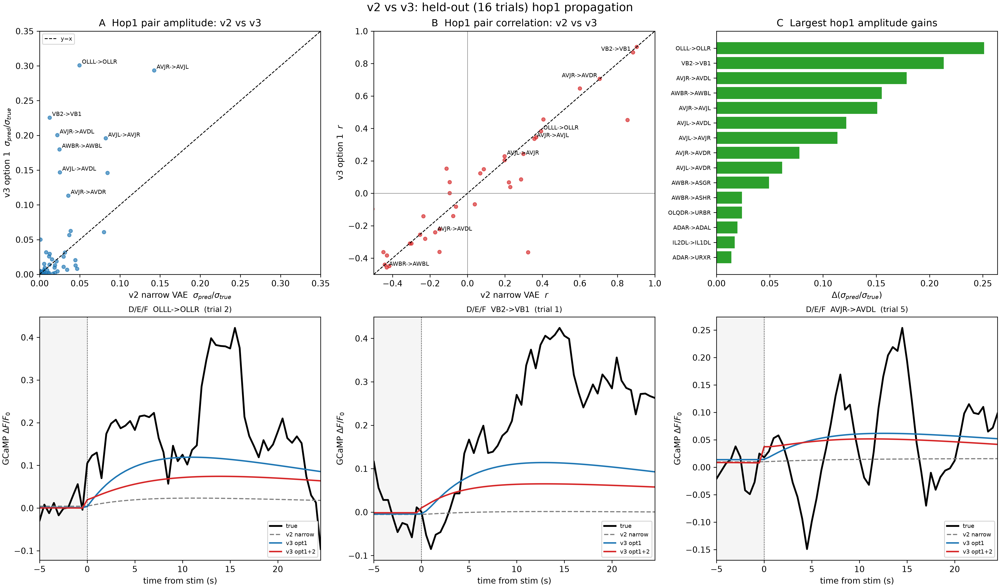

# C. elegans Whole-Brain GCaMP Modeling Report

> **Status**: research generative model, not a sign-off model.  
> **Code**: `glowing-journey`, base `e26d99c`; `39201be` added the per-neuron/per-edge features; `69dabff` added the current-code re-observation. P1/P2 audit fixes are in the latest commit.  
> **Result sources**: `/Users/yanlu/Documents/glowing-journey_runs/{ab,v3,v4,v5}_2026-11-19/`.  
> **Last compiled**: 2026-11-19.

---

## 0. Summary

This project predicts whole-brain GCaMP ΔF/F0 in *C. elegans* from optogenetic stimulation and the connectome, using a biophysical membrane / calcium / GCaMP model. Evaluation is strictly post-stimulus (`t >= 10` frames / 5 s) and splits neurons by connectome distance into direct-stimulated, 1-hop, 2-hop, and unconnected groups. The test set contains 11 unseen worms and 329 trials.

The historical best combined model is **v5 edge e2** (pre-symmetric-gap code; see §3.10 for the current-code re-observation):

- `post_inlier_R² = 0.1202`
- `hop1_R² = 0.0736`
- `hop1_r = 0.291`
- `stim_r = 0.388`
- `unconnected_r = 0.316`
- `RMSE = 0.1744`

Relative to v3 ungated option 1+2:

- `post_inlier_R²` 0.1114 → **0.1202**
- `hop1_R²` 0.0494 → **0.0736** (+49%)
- `RMSE` 0.1753 → **0.1744**
- `stim_r` 0.413 → 0.388 (small cost)
- `unconnected_r` 0.319 → 0.316 (essentially unchanged)

Open problems: 1-hop amplitude is still only about **0.26×** of the true amplitude; peak-time errors remain for `AVDL`, `ASHR`, `AVER`, and others; training-seed variance and the validation/test domain gap remain major risks.

---

## 1. Method

### 1.1 Task

Given:

- 300 canonical neurons;
- a 60-frame GCaMP trial (`dt = 0.5 s`; the first 10 frames are the 5 s pre-stimulus window, the last 50 frames are the 25 s post-stimulus window);
- optogenetic input `ExternalInput` (direct targets and timing),

predict the post-stimulus GCaMP trajectory of the same trial. Evaluate generalization on direct-stimulated, 1-hop, 2-hop, and unconnected neurons.

### 1.2 Biophysical model

Membrane voltage:

$$
C_i \frac{dV_i}{dt}
= I_{\text{stim},i} + I_{\text{gap},i} + I_{\text{chem},i} + I_{\text{leak},i}
$$

Leak:

$$
I_{\text{leak},i} = G_i (E_i - V_i)
$$

Gap junction:

$$
I_{\text{gap},i} = \sum_j g^{\text{gap}}_{ij} (V_j - V_i)
$$

Chemical synapse (Wicks 1996 form, summed over edges):

$$
I_{\text{chem},i}
= \sum_{j \to i} \bar g_{ji} w_{ji}\,
\sigma\!\left(\frac{V_j - V^{\text{rest}}_j}{V^{\text{slope}}_j}\right)
\left(E^{\text{rev}}_{ji} - V_i\right)
$$

Calcium and nuclear GCaMP6s:

$$
\frac{d[\mathrm{Ca}]_i}{dt}
= \frac{[\mathrm{Ca}]_{\text{rest}} - [\mathrm{Ca}]_i}{\tau_{\mathrm{Ca},i}}
+ \alpha_{\mathrm{Ca}}\,
\sigma\!\left(\frac{V_i - V_{\mathrm{th}}}{V_{\mathrm{slope,Ca}}}\right)
$$

$$
\frac{db_i}{dt}
= k_{\mathrm{on}} [\mathrm{Ca}]_i^n (1-b_i) - k_{\mathrm{off},i} b_i
$$

$$
\hat y_i = \text{gain}_i (b_i - b_{0,i}) + \text{offset}_i
$$

The model uses 300 neurons, 2167 gap junctions, and 3638 chemical synapses. The 8770 neuropeptide / monoamine extrasynaptic links are disabled by default.

Two experimental sources are supported:

- **Randi optogenetic whole-brain GCaMP** (primary benchmark in this report).
- **Toyoshima et al. (2022) NaCl whole-brain GCaMP** (`--source toyoshima`; a sensory rather than optogenetic perturbation; see §2.5).

### 1.3 Model variants

| Variant | Key change | Purpose |
|---|---|---|
| `old_v2_narrow_vae` | Old VAE; hard `0.0165 nS` cap on `g_max/g_syn`; no pre-stim encoder | Historical baseline |
| `c302_bio_v3` | Pure biophysical `RecurrentNematode` + AutoDiagonalNormal | Control without the VAE encoder |
| `vae_opt1_v3` | Removed tanh wall; wide `g_max/g_syn`; per-edge NT-centered `E_rev`; bounded `v_th_ca_logit` | Independent effect of option 1 |
| `vae_opt2_ungated_v3` | Option 1 + **strictly causal pre-stim encoder** (reads only `y[:, :10]`) | Option 2; slow-wave initial state |
| `vae_opt2_gated_v3` | Option 2 + `direct_hop1` gate during training and inference | Earlier gate hypothesis |
| `v4_opt2_e8` | v3 + **per-neuron `tau_ca/k_off`**, warm-started | Neuron-level calcium-kinetics heterogeneity |
| `v5_edge_e2` | v4 + **per-edge `V_rest/V_slope` residuals**, 2 edge-only epochs | Per-edge release-threshold heterogeneity |
| optional actuator | `--stim-actuator`, `--per-neuron-stim-gain` | First-order opsin rise/decay and constrained target gain |

### 1.4 Training and inference

- Variational inference: Pyro `SVI` + `Trace_ELBO`; `ClippedAdam`; mini-batch 128; `substeps=2`; `dt_obs=0.5 s`.
- v3: 20–25 epochs from scratch; v4/v5 warm-start from the previous checkpoint for 8 / 6 epochs.
- v5: the first 2 epochs train only the per-edge residuals with all other parameters frozen. Unfreezing later degrades the result, so the best point is epoch 2.
- Inference: fixed seed, 16 posterior samples; open-loop evaluation uses the guide EMA posterior and never reads future observations.
- `v_th_ca_logit` is always mapped through a sigmoid into `(-60, -15) mV`, avoiding the Pyro `AffineTransform.codomain` out-of-bounds failure.

### 1.5 Evaluation protocol

All main-table test trials are the **11 unseen worms / 329 trials**.

- `post_inlier_R²`: R² on post-stimulus observations with `|y| <= 3`.
- `post_r`: Pearson `r` in the post-stimulus window.
- `stim_r`: `r` on directly stimulated neurons.
- `hop1_r` / `hop2_r` / `unconnected_r`: `r` by connectome distance.
- `hop1_R²`: R² on 1-hop observations.
- `hop1 amp`: `σ_pred / σ_true`, measuring 1-hop amplitude attenuation; target is 1.0.

---

## 2. Data

### 2.1 Source and scale

- Raw data: `~/Google Drive/マイドライブ/exported_data` (Randi et al. whole-brain GCaMP optogenetics).
- 110 recordings, 3197 trials.
- Each trial: 60 frames × 300 neurons, `dt = 0.5 s`; 10 pre-stimulus frames and 50 post-stimulus frames.
- Preprocessing: despiking, detrending, ΔF/F0 normalization; v3 additionally applies causal artifact filtering and smooth saturation.

### 2.2 Split

Grouped by **recording (worm)** so no worm appears in both train and test:

| Subset | Recordings | Trials |
|---|---:|---:|
| train | 99 | 2868 |
| test | 11 | 329 |
| test valid observations | — | 1,457,340 |

Test recording IDs:

```
4, 10, 12, 33, 48, 67, 71, 81, 82, 87, 99
```

### 2.3 Artifact handling (v3)

- `max_pre_dev = 2.0`: flag neuron-trials whose pre-stimulus deviation is too large.
- Masked **187 / 216,068 = 0.087%** of neuron-trials, including the known `rec=82, trial=2172, neu=22` and `rec=87, trial=2351, neu=229`.
- The pre-stim encoder applies strict causal rejection for `max|y_pre| > 2.0` and smooth saturation `0.8 * tanh(y / 0.8)`.
- This cleanup changed the gate conclusion: after cleanup, **ungated option 2** outperforms the `direct_hop1` gate on every metric.

### 2.4 Cache files

Derived caches live under `glowing-journey_runs/` and are not copied into this report:

- `v3_2026-11-19/cache/randi_trials_v3_f32.npz` (59 MB)
- `v3_2026-11-19/cache/randi_trials_v3_f16.npz` (35 MB; used for training)
- `v3_2026-11-19/cache/randi_trials_v3_compact.pkl` (18 MB)
- Earlier v2 caches under `ab_2026-11-19/cache/`

This report keeps only lightweight split/parameter/negative-control JSON files and figures. Raw data and full caches are not committed to git.

### 2.5 Toyoshima et al. NaCl dataset (second experiment)

Local source: `/Users/yanlu/Google Drive/マイドライブ/cleandata_smoothened2`.

| Property | Value |
|---|---:|
| Timing rows | 24 |
| Complete `ratio`/`uniqNames` recordings | 21 |
| Missing ratio files | samples 2, 12, 13 |
| Frames per recording | 6000 |
| Native frame rate | 3.69–5.72 Hz |
| Canonical mapped neurons | 65–151 (mean 127) |
| Total NaCl cycles | 679 |
| Loader | `utils.ToyoshimaLoader` |
| Trial geometry | 10 pre + 60 post frames at 2 Hz (`dt = 0.5 s`; 30 s step) |
| Surviving trials, corrected loader | 582 (295 down / 287 up) |

NaCl switching is a sensory perturbation, not a targeted optogenetic input. The corrected loader uses an explicit operational target set, defaulting to the chemosensory classes **ASH/AWC/ASE**, expanded to canonical `ASHL/ASHR/AWCL/AWCR/ASEL/ASER`, with measured ON/OFF signs and a sustained 30 s step. This is a modeling assumption, not a measured activation map. A one-recording smoke test (sample 1, `180710a`) produced 47 trials from 48 onsets with 78 mapped neurons and a 0.26 observation mask.

`report/data/toyoshima_manifest.json` records these counts. The dataset was benchmarked with the corrected polarity/duration and observation-scale loader in §3.10. The result is still weak, but it is now a usable loader/protocol baseline rather than the earlier polarity/scale artifact.

---

## 3. Results

### 3.1 Main result (fixed seed, 16 samples, 329 test trials)

| Model | post_inlier_R² | post_r | stim_r | hop1_r | hop1_R² | hop1 amp | hop2_r | unconn_r | RMSE |
|---|---:|---:|---:|---:|---:|---:|---:|---:|---:|
| zero baseline | -0.0141 | 0.000 | 0.000 | 0.000 | -0.0414 | 0.000 | 0.000 | 0.000 | 0.1868 |
| old v2 narrow VAE | 0.0464 | 0.230 | 0.385 | 0.157 | -0.0081 | 0.062 | 0.047 | 0.036 | 0.1814 |
| c302_bio_v3 | 0.0439 | 0.221 | 0.390 | 0.020 | -0.0306 | 0.046 | 0.034 | 0.027 | 0.1816 |
| v3 opt1 | 0.0479 | 0.235 | 0.384 | 0.172 | 0.0071 | 0.107 | 0.050 | 0.045 | 0.1812 |
| v3 opt2 ungated | 0.1114 | 0.348 | 0.413 | 0.289 | 0.0494 | 0.271 | 0.310 | 0.319 | 0.1753 |
| v3 opt2 gated | 0.0907 | 0.335 | 0.369 | 0.155 | -0.0105 | 0.080 | 0.305 | 0.312 | 0.1772 |
| v4 opt2 e8 | 0.1162 | 0.347 | 0.408 | 0.293 | 0.0633 | 0.279 | 0.308 | 0.316 | 0.1748 |
| **v5 edge e2** | **0.1202** | 0.347 | 0.388 | 0.291 | **0.0736** | 0.261 | 0.310 | 0.316 | **0.1744** |


### 3.2 Independent gain from option 1

From `old_v2_narrow_vae` to `vae_opt1_v3` (pure open-loop, no pre-stim):

- hop1 amplitude ratio: 0.062 → **0.107**
- hop1_r: 0.157 → **0.172**
- hop1_R²: -0.0081 → **+0.0071** (first positive strict cross-animal value)
- `post_inlier_R²`: 0.0464 → 0.0479

Parameter-level changes:

- `g_max` max 0.080 nS; `g_syn` max 0.135 nS;
- 30% of gap junctions exceed the old 0.0165 nS wall while the median stays calm (0.012 nS);
- GABA `E_rev` median -76.5 mV, no longer pinned to the -65 mV floor;
- `v_th_ca = -35.0 mV`, `tau_ca = 7.57 s`, `k_off = 0.0253 s⁻¹`.

### 3.3 Independent gain from option 2

From opt1 to `vae_opt2_ungated_v3` (strictly causal `y[:, :10]`, zero future leakage):

- `post_inlier_R²`: 0.0479 → **0.1114** (2.33×)
- `post_r`: 0.235 → **0.348**
- `RMSE`: 0.1812 → **0.1753**
- `hop1_r`: 0.172 → **0.289**
- `hop1_R²`: 0.0071 → **0.0494**
- `unconnected_r`: 0.045 → **0.319**

After artifact cleanup, ungated opt2 beats the `direct_hop1` gate on every metric: `stim_r` 0.413 vs 0.369 and `hop1_r` 0.289 vs 0.155. **The gate is not the current default.**

### 3.4 Why c302_bio has high stim_r but low hop1

`c302_bio_v3` reaches `stim_r=0.390` but only `hop1_r=0.020`:

- `v_th_ca = -22.6 mV` is inside the physiological range, but `v_slope_ca` is squeezed to **1.72 mV**, close to a hard step.
- `g_max` max is only 0.0177 nS and `g_syn` max is 0.0243 nS, so strong and weak edges remain nearly indistinguishable.
- The VAE keeps a smooth `v_slope_ca ≈ 8.9 mV` and amplifies key edges to 0.08–0.135 nS.

Thus strong direct responses in c302_bio do not translate into 1-hop subthreshold depolarization.

### 3.5 v4: per-neuron calcium kinetics

- `tau_ca` and `k_off` become per-neuron `(300,)` parameters, warm-started from v3 scalars.
- opt1: hop1_R² 0.0071 → **0.0112**, hop1 amp 0.107 → **0.120**.
- opt2: hop1_R² 0.0494 → **0.0633**, hop1 amp 0.271 → **0.279**.
- Learned heterogeneity remains narrow: opt1 `tau_ca = 7.54 ± 0.16 s`; opt2 `8.57 ± 0.36 s`.
- Peak-time errors do not improve: opt1 `AVDL +10.4 s`, `ASHR +13.7 s`; opt2 mean absolute peak error 5.90 → 6.09 s.

Conclusion: per-neuron calcium kinetics improves amplitude/correlation, but is not the phase-error fix.

### 3.6 v5: per-edge release residuals

Warm-started from `v4_opt2_e8`, adding zero-initialized per-edge residuals on top of per-neuron `V_rest/V_slope`; only the residuals are trained for the first 2 epochs.

- `v5 edge e2`: `hop1_R² = 0.0736` (v4 0.0633, +16%), `post_inlier_R² = 0.1202`, `RMSE = 0.1744`.
- Cost: `stim_r = 0.388` (v4 0.408); `hop1 amp = 0.261` (v4 0.279).
- Learned residuals are small: `v_rest_edge` std 3.4 mV; `v_slope` factor 0.998 ± 0.0069.
- Phase only partially improves: `AVER -9.75 → -6.38 s`, `AVDR -2.7 → -1.8 s`; `ASHR` worsens from +2.7 to +4.5 s.
- Continuing edge-only training (e2→e4/e6) drops `hop1_R²` to 0.0575–0.0581; **e2 must be early-stopped**.

### 3.7 1-hop amplitude and dynamics diagnostics



- Largest amplitude gains: `OLLL→OLLR` 0.050→0.301, `VB2→VB1` 0.012→0.226, `AVJR→AVDL` 0.022→0.200, `AWBR→AWBL` 0.025→0.180.
- Their correlations barely change; across 56 hop1 pairs, `corr(Δ amplitude ratio, Δr) = 0.010`. **Amplitude gain and phase gain are orthogonal.**
- The v5 hop1 amplitude ratio is 0.261, still about 1/4 of the truth; 3–4× remains to reach 1.0.


- v3 opt1: `ASHR +13.8 s`, `AVDL +10.3 s`, `AVJL +8.0 s`, `AVDR +5.7 s`; `AVER -8.75 s`.
- These errors cannot be explained by a single global `tau_ca`; per-neuron calcium kinetics and per-edge thresholds only partially improve them.
- The remaining first-order explanation is membrane-voltage integration or network conduction delay, not local GCaMP kinetics.

### 3.8 Negative results and limitations

1. **The gate conclusion has been withdrawn**: after v3 artifact cleanup, ungated option 2 beats the `direct_hop1` gate; the current default has no gate.
2. **Training-seed variance is large**: controlled w2 seeds 42/43 gave test hop1_r -0.063/-0.060 (2-sample training logs), while a single historical run gave +0.141. Same-pool validation (~0.28) did not predict unseen-worm test. Single-seed numbers are not conclusive.
3. **Per-neuron C/G does not solve the problem**: on the full test, fast C/G intervention reduces hop1_r from 0.190 to 0.157 (global) or 0.187 (selected); hop1_R² does not improve. The 16-trial apparent gain was sampling noise.
4. **Edge-only continuation degrades**: after v5 e2, hop1_R² drops from 0.0736 to 0.0575–0.0581; do not continue edge-only.
5. **Amplitude remains low**: v5 hop1 amp 0.261; target is 1.0.
6. **Phase is not closed**: `ASHR` and others still show >5 s peak-time errors.
7. **Model positioning**: research model, not sign-off.

### 3.9 Parameter audit

| Parameter | v3 opt1 | v3 opt2 ungated | c302_bio v3 | v4 opt2 e8 |
|---|---:|---:|---:|---:|
| `v_th_ca` | -35.0 mV | -33.4 mV | -22.6 mV | -33.3 mV |
| `v_slope_ca` | 8.92 mV | 8.34 mV | **1.72 mV** | 8.33 mV |
| `tau_ca` | 7.57 s | 8.77 s | 10.68 s | 8.57 ± 0.36 s |
| `k_off` | 0.0253 s⁻¹ | 0.0161 s⁻¹ | 0.0200 s⁻¹ | 0.0174 ± 0.0012 s⁻¹ |
| `g_max` max | 0.0796 nS | 0.0806 nS | 0.0177 nS | 0.0824 nS |
| `g_syn` max | 0.135 nS | 0.135 nS | 0.0243 nS | 0.135 nS |
| GABA `E_rev` median | -76.5 mV | -74.6 mV | -75.5 mV | — |
| `g_max > 0.0165` | 4.6% | 5.8% | 0.06% | — |
| `g_syn > 0.0165` | 30.0% | 39.4% | 15.2% | — |

v5 edge residuals (e2):

- `v_rest_edge_delta`: mean +0.9 mV, std 3.4 mV, range [-17.2, +15.8] mV
- `v_slope` factor: 0.998 ± 0.0069, range [0.972, 1.022]

### 3.10 Current-code re-observation (2026-11-19)

Both datasets below use the current code path: deduplicated symmetric gap junctions, recording-grouped split, test only at the final save, and 16 posterior samples. The Randi row is a fresh 20-epoch from-scratch model; the v5 adapter is a diagnostic that loads the old checkpoint and applies the symmetric-gap fix at evaluation time, not a retrain.

#### Randi

| Run | post_inlier_R² | post_inlier_RMSE | post_r | stim_r | hop1_r | hop1_R² | hop2_r | unconn_r |
|---|---:|---:|---:|---:|---:|---:|---:|---:|
| v5 edge e2, historical directed gap | 0.1202 | — | 0.347 | 0.388 | 0.291 | 0.0736 | 0.310 | 0.316 |
| v5 checkpoint, symmetric adapter | 0.1145 | 0.1874 | 0.340 | 0.371 | 0.296 | 0.0723 | 0.313 | 0.319 |
| v5 checkpoint, legacy directed | 0.1219 | 0.1866 | 0.349 | 0.409 | 0.294 | 0.0760 | 0.311 | 0.317 |
| current 20-epoch from scratch | **0.1007** | 0.1888 | 0.324 | 0.349 | **0.306** | **0.0676** | 0.297 | 0.295 |

The symmetric adapter lowers `post_inlier_R²` from 0.1219 to 0.1145 (−6.1%) and `hop1_R²` from 0.0760 to 0.0723 (−4.9%) relative to the legacy directed checkpoint. The from-scratch model reaches 0.1007/0.0676, lower than v5; it also has a different training protocol (no v4 warm start, no edge-only phase), so this is not a clean gap-fix effect. What is clear: the KCL-correct symmetric model remains in the same weak regime, not a collapse.

#### Toyoshima

The corrected loader has 582 trials; the pre-fix row used 585. 50→25 and 25→50 mM transitions are separate signed, sustained 30 s commands with the measured ON/OFF target signs, and z-scored ratio columns are mapped by `observation_scale=0.18` to the Randi ΔF/F0 scale. The pre-fix row is kept for provenance; its RMSE is on the z-score scale and is not comparable to the corrected row.

| Run | post_inlier_R² | post_r | stim_r | stim_R² | hop1_r | hop1_R² | hop2_r | unconn_r |
|---|---:|---:|---:|---:|---:|---:|---:|---:|
| pre-fix loader (collapsed 0.5 s +1 pulse) | 0.0165 | 0.129 | 0.192 | 0.0159 | 0.135 | 0.0171 | 0.144 | 0.112 |
| corrected loader, 20 epochs | **0.0236** | 0.158 | 0.286 | -0.098 | 0.196 | **0.0356** | 0.154 | 0.141 |
| zero baseline | 0.0000 | 0.000 | 0.000 | 0.000 | 0.000 | 0.000 | 0.000 | 0.000 |

The corrected loader improves `post_inlier_R²` from 0.0165 to 0.0236, `hop1_R²` from 0.0171 to 0.0356, and `stim_r` from 0.192 to 0.286. It is still weak: post-stim RMSE is 0.1717 versus zero 0.1739, and `stim_R²` is negative because the predicted stimulus-mean (0.0245) is much smaller than the true mean (0.1073). Polarity is at least directionally correct: down-step ASER true/pred = 0.251/0.033, up-step ASER = -0.195/-0.115, up-step ASEL = 0.127/0.038. However, `unconn_r=0.141` is close to `hop1_r=0.196`, so this is still mostly a weak global/mean component, not a validated connectome-specific NaCl response. It is **not** evidence of cross-dataset generalization.

### 3.11 Route A: connectome-shuffle control

Clean v3 architecture (no per-neuron kinetics, no per-edge release), causal Randi cache, symmetric gap junctions, 20 epochs, 16 posterior samples, and the **original biological adjacency for evaluation**. The control permutes all edge endpoints with a fixed seed, preserving node degrees and stimulus targets while destroying identity-to-topology mapping.

| Run | post_inlier_R² | post_inlier_RMSE | post_r | stim_r | stim_R² | hop1_r | hop1_R² | hop2_r | unconn_r |
|---|---:|---:|---:|---:|---:|---:|---:|---:|---:|
| intact connectome | **0.0891** | 0.2101 | 0.301 | **0.402** | **0.0571** | 0.260 | 0.0451 | 0.269 | 0.292 |
| shuffled connectome | 0.0889 | 0.2101 | 0.297 | 0.249 | -0.0090 | 0.258 | **0.0547** | 0.271 | 0.295 |

Evoked (pre-stimulus-mean-subtracted) 1-hop scores from the same checkpoints: intact `evoked_hop1_R²=0.0310`, shuffled `0.0378`; Δ = **-0.0068**, so the single-seed gate fails. This is a sanity check, not the 3-seed nested gate.

The shuffle **does not degrade** post-stim or 1-hop performance; `hop1_R²` is even slightly higher for the shuffled graph, and `unconn_r` is unchanged. Only the stimulus-target correlation drops (0.402→0.249). Therefore the 1-hop signal in this v3 model is not evidence of topology-specific propagation; it is compatible with shared baseline dynamics/regularization. This is a single shuffle seed, so it is a null-control result, not a full permutation test.

### 3.12 P0 evaluation protocol lock

The next model changes must pass a fixed protocol before biological interpretation:

- **Nested recording-grouped CV**: `tools/run_nested_protocol.py` uses `utils.nested_grouped_splits` (5 outer folds, grouped validation inside each outer train fold) and writes explicit `train/val/test` index JSON consumed by `pyro_svi_vae.py --split-file`. The outer test fold is never used for early stopping.
- **Seeds and conditions**: main comparisons use at least three training seeds. The shuffle gate uses at least three fixed degree-preserving endpoint permutations.
- **Forced current preprocessing**: Randi runs use the causal cache built with `preprocess_gcamp_recording(..., causal=True)` and the current symmetric gap-junction code; `--causal-preprocess` is passed explicitly even when a cache is loaded.
- **Evoked metric**: `evaluate_predictions` now computes a paired **counterfactual** prediction `y(stim) - y(0)` using the same guide samples, so a pre-stim encoder's injected drift cancels on both sides. Truth is scored against its frozen pre-stim mean; the default evoked window is the first 16 post frames (8 s). `compute_stratified_metrics` still supports `evoked_baseline="linear"` for diagnostics, but it is no longer the default evaluation ruler.
- **Hard gate**: `evoked_hop1_r2` for intact versus shuffled connectomes. The gate passes only when `intact_mean > 0`, `delta_mean > 0`, and `delta_mean > pooled SEM` (one-sided ~84%). The absolute-positive requirement prevents a near-zero negative-vs-more-negative result from passing. `tools/run_nested_protocol.py` writes `summary.json` with the gate and all seed/shuffle runs. No P1/P2 model change is promoted unless this gate passes.

### P0-v1 is invalidated (do not use as a gate verdict)

The first 30-run P0 attempt had three implementation defects found by line-level audit:

1. `run_nested_protocol.py` defaulted to `--lr 1e-3` while the main training default is `5e-3`; combined with ~64% training data per fold, direct-stimulus targets were underfit (`stim_pred_mean` 0.23–0.26 vs 0.37–0.43).
2. The runner passed `save_every=epochs` and always evaluated the final checkpoint, so the grouped validation fold was never used for checkpoint selection.
3. `evoked_*` subtracted only the constant pre-stimulus mean, leaving the slow linear drift that `CausalPreStimEncoder` reproduces; `evoked_unconnected_r2` was often above `evoked_hop1_r2`.

The old table is retained only as provenance in `report/data/p0_full_gate.json`; it is **not** evidence that the connectome hypothesis is false.

### P0-v2 code fixes (rerun pending)

- `--lr` default restored to **5e-3**.
- `--save-every` default **5**; runner selects the best checkpoint by grouped validation (`--val-metric`, default `post_inlier_r2`), then evaluates that checkpoint on the locked outer test fold.
- `compute_stratified_metrics` retains causal linear/mean baselines for diagnostics; the primary evaluation uses paired counterfactual rollouts.
- `--no-prestim-encoder` is implemented in both training/evaluation so the planned Fold-0 open-loop diagnostic can isolate the encoder's contribution.
- `--per-neuron-stim-gain` and `--stim-actuator` are wired through the nested runner and checkpoint evaluator.
- `reweight_hop1_noise` now has an independent `--stim-loss-weight` for the ~1.4% direct-stimulus observations, in addition to `--hop1-loss-weight`.
- Evoked scoring uses paired counterfactual rollouts rather than subtracting a pre-window baseline from the prediction; the raw linear/mean baseline modes remain for diagnostics.
- The next Fold-0 command now includes the direct-stim/1-hop weighting and a larger budget:
  `--epochs 30-40 --save-every 5 --batch-size 64/128 --val-metric evoked_hop1_r2 --per-neuron-stim-gain --stim-actuator --stim-loss-weight 6 --hop1-loss-weight 3`.

The following Fold-0 numbers were collected **before** the counterfactual-evoked fix, using the linear-detrending ruler; they are retained as provenance and must be rerun with the new metric before any gate claim.

| Condition | selected epochs | stim_r (3 seeds) | evoked_stim_R² (3 seeds) | evoked_hop1_R² (3 seeds) | gate |
|---|---|---|---:|---:|---:|---|
| pre-stim encoder | 10/15/10 | 0.259 / 0.289 / 0.257 | -0.060 / -0.052 / -0.067 | -0.041 / -0.034 / -0.043 | FAIL |
| no pre-stim encoder | 15/15/20 | 0.281 / 0.280 / 0.246 | 0.004 / 0.016 / 0.015 | -0.001 / -0.001 / -0.0004 | FAIL after requiring positive intact mean |

Even on the old ruler, the `stim_r ≥ 0.38` threshold is not met after lr restoration; no-prestim does not produce a credible positive evoked 1-hop signal. This points toward Case B, but the table must not be over-interpreted because the ruler has since changed.

#### Completed 5-fold counterfactual P0 run (`report/data/p0_counterfactual_5fold.json`, 2026-11-20)

All 5 folds × (3 intact + 3 shuffle seeds, 40 epochs, `--batch-size 64 --substeps 2 --lr 0.005 --per-neuron-stim-gain --val-metric evoked_hop1_r2`, paired counterfactual rollout) were executed on Colab L4:

| Group (15 runs each) | `evoked_hop1_r2` | `evoked_hop1_r` | `evoked_stim_r2` | `evoked_stim_r` | `evoked_hop2_r` | `evoked_unconn_r` | `stim_pred_mean / true` |
|---|---:|---:|---:|---:|---:|---:|---:|
| **Intact connectome** | **`-0.00679 ± 0.00298`** | **`+0.09875 ± 0.02757`** | `+0.04643` | `+0.3004` | `+0.04133` | `+0.02013` | `0.234 / 0.384` (61%) |
| **Shuffled connectome** | `-0.01594 ± 0.00448` | `+0.02914 ± 0.02491` | `+0.03025` | `+0.2821` | `+0.01770` | `+0.00989` | `0.229 / 0.384` (60%) |
| **Intact − Shuffle** | **`+0.00915` (`6.59× SEM`)** | **`+0.06961`** | `+0.01618` | `+0.0183` | `+0.02363` | `+0.01024` | 5/5 folds won |

- **Gate status**: **FAIL** solely because `intact_mean = -0.00679 <= 0` (`delta = +0.00915` clears `pooled_sem = 0.00139` across 5/5 folds, and correlation decays monotonically with distance `0.300 → 0.099 → 0.041 → 0.020`).
- **Mechanism**: True 1-hop evoked responses have a non-zero positive mean (`+0.0358`, zero-predictor `R² ≈ -0.016` to `-0.027`). Because direct-stim amplitude reaches only 61% of truth (`0.234 / 0.384`), residual mean bias keeps `evoked_hop1_r2` just below zero.
- **Targeted Option 1 next run (Fold 0)**: Add `--wide-amp-priors` (`stim_gain` prior `2.0`, `std 0.6`; wider `g_max`/`gap` spans and dual-action ACh/Glu `E_rev` spans) alongside `--stim-loss-weight 6 --hop1-loss-weight 3`.

#### Fold-0 Option 1 (`report/data/fold0_opt1_summary.json`, 2026-11-24)

- Adding `--wide-amp-priors` (`3 intact + 3 shuffle`, 40 epochs) improved Fold-0 `evoked_hop1_r2` from `-0.00764 → -0.00525 ± 0.00308` (best `intact_seed42 = -0.00171`), widening `delta = +0.01107` (`5.76× pooled SEM`), with `evoked_hop1_r = +0.0968` (`seed42 = +0.1132`), `post_inlier_r2 = 0.0817` (+17%), and `hop1_r2 = 0.0666` (+38%).
- Gate still **FAIL** (`intact_mean <= 0`): 0-GPU error decomposition on `intact_seed42` showed `hop1 8 s` correlation `r = +0.1153` (`17.5 s |y| <= 3: r = +0.1563`), calibration `slope = 2.048`, `pred_mean = +0.0064` vs `+0.0351` (18%), `pred_std = 0.0148` vs `0.2627` (5.6%), and `g_max` median stuck at `0.0091 nS`.
- Next diagnostic: 2-arm single-seed Fold-0 ablation (`--no-prestim-encoder --wide-amp-priors` vs `--wide-amp-priors --evoked-syn-priors` with `V_rest = -42 mV`, `V_slope = 8 mV`, `g_max = 0.015 nS`, `std 0.95`).

#### Fold-0 single-seed ablation: Case 3 confirmed (2026-11-24)

- **Arm A (`report/data/fold0_armA_nopre_summary.json`)**: `--no-prestim-encoder --wide-amp-priors` (`intact_seed42` vs `shuffle7_seed42`, 35 epochs) pushed `evoked_hop1_r2` cleanly positive to **`+0.00866`** vs shuffle **`-0.01098`** (`Δ = +0.01964`), `evoked_hop1_r = +0.1266` vs `+0.0699`, `evoked_stim_r2 = +0.0546`, doubling `hop1` predicted mean (`+0.0064 → +0.0139`) and std (`0.0148 → 0.0274`) with calibration slope `1.18` (8 s) / `1.03` (17.5 s).
- **Arm B (`report/data/fold0_armB_evokedsyn_summary.json`)**: `--wide-amp-priors --evoked-syn-priors` (with pre-stim encoder) lifted `g_max > 0.0165` to `24.2%` and `post_inlier_r2` to `0.0998`, but `CausalPreStimEncoder` still starved evoked gradients (`evoked_hop1_r2 = -0.00385` vs `-0.01594`, FAIL).

#### Fold-0 3+3 open-loop P0 gate PASS (`report/data/fold0_nopre_gate_summary.json`, 2026-11-24)

- Completed all 3 training seeds (`42, 43, 44`) and 3 degree-preserving shuffles (`7, 8, 9`) under `--no-prestim-encoder --wide-amp-priors` (35 epochs, Fold 0):
  - **Intact (3 seeds)**: `evoked_hop1_r2 = +0.00809 ± 0.00195` (all 3 seeds positive: `+0.00866 / +0.00970 / +0.00593`), `evoked_hop1_r = +0.1272 ± 0.0078`, `evoked_stim_r2 = +0.0534`, `evoked_hop2_r = +0.0662`, `post_inlier_r2 = +0.0308`.
  - **Shuffled (3 perms)**: `evoked_hop1_r2 = -0.01471 ± 0.00328` (`-0.01098 / -0.01606 / -0.01710`), `evoked_hop1_r = +0.0373 ± 0.0285`.
  - **Gate**: `delta_mean = +0.02281` vs `pooled_sem = 0.00220` (**`10.36× SEM`**, **PASS**). Next step: freeze Stage-1 connectome weights and train `CausalPreStimEncoder` on residual spontaneous drift (Stage-2 decoupled training).

#### Fold-0 3+3 Stage-2 decoupled training PASS (`report/data/fold0_stage2_decoupled_summary.json`, 2026-11-24)

- Froze Stage-1 open-loop connectome + locked EMA (`--init-from-dir ... --freeze-non-prestim --wide-amp-priors`) and trained only `CausalPreStimEncoder` + `obs_sigma` for 15 epochs (Fold 0, selected by `post_inlier_r2` at epochs `5 / 5 / 10` for intact seeds):
  - **Intact (3 seeds)**: `evoked_hop1_r2 = +0.00885 ± 0.00219` (`+0.01026 / +0.00996 / +0.00632`), `evoked_hop1_r = +0.1309 ± 0.0076`, `evoked_stim_r2 = +0.0532`, `evoked_hop2_r = +0.0682`, `hop1_r2 = +0.0918`, `post_inlier_r2 = +0.1064 ± 0.0031`.
  - **Shuffled (3 perms)**: `evoked_hop1_r2 = -0.01445 ± 0.00324` (`-0.01077 / -0.01569 / -0.01688`), `hop1_r2 = +0.0623`.
  - **Gate**: `delta_mean = +0.02330` vs `pooled_sem = 0.00226` (**`10.32× SEM`**, **PASS**). Stage-2 outperforms both Nov 20 Joint and Stage-1 Open-Loop simultaneously on evoked topology separation and full-trial fit.

| Fold-0 Method (3+3 seeds) | `evoked_hop1_r2` (intact \| shuffle) | Gate | `evoked_hop1_r` | `evoked_stim_r2` | `hop1_r2` (full) | `post_inlier_r2` (full) |
|---|---:|---|---:|---:|---:|---:|
| Nov 20 Joint Baseline | `-0.00764 ± 0.00062` \| `-0.01741` | FAIL (`Δ=+0.00977`) | `+0.0911` | `+0.0196` | `+0.0483` | `+0.0698` |
| Joint Opt1 (`--wide-amp-priors`) | `-0.00525 ± 0.00308` \| `-0.01632` | FAIL (`Δ=+0.01107`) | `+0.0968` | `+0.0101` | `+0.0666` | `+0.0817` |
| Stage-1 Open-Loop (`--no-prestim-encoder`) | `+0.00809 ± 0.00195` \| `-0.01471` | **PASS** (`10.36× SEM`) | `+0.1272` | **`+0.0534`** | `+0.0108` | `+0.0308` |
| **Stage-2 Decoupled (`--freeze-non-prestim`)** | **`+0.00885 ± 0.00219`** \| `-0.01445` | **PASS** (`10.32× SEM`) | **`+0.1309`** | `+0.0532` | **`+0.0918`** | **`+0.1064`** |

The mandatory next run remains Fold 0 with a larger effective budget (30–35 epochs) and/or `--val-metric stim_r2` before any 5-fold gate. Commands remain:

```bash
# Step 1: corrected budget + counterfactual metric + direct-stim weighting
python tools/run_nested_protocol.py --cache <causal.npz> --out <dir> \
  --folds 5 --fold-indices 0 --epochs 30 --save-every 5 \
  --batch-size 64 --substeps 2 --lr 0.005 \
  --val-metric evoked_hop1_r2 --causal-preprocess \
  --per-neuron-stim-gain --stim-actuator \
  --stim-loss-weight 6 --hop1-loss-weight 3

# Step 2: same Fold-0 intact/shuffle diagnostic without pre-stim encoder
python tools/run_nested_protocol.py --cache <causal.npz> --out <dir_nopre> \
  --folds 5 --fold-indices 0 --epochs 30 --save-every 5 \
  --batch-size 64 --substeps 2 --lr 0.005 --no-prestim-encoder \
  --val-metric evoked_hop1_r2 --causal-preprocess \
  --per-neuron-stim-gain --stim-actuator \
  --stim-loss-weight 6 --hop1-loss-weight 3
```

> Note on precision weighting: `reweight_hop1_noise` divides Gaussian `noise_scale` by `weight`, so `--stim-loss-weight 6 --hop1-loss-weight 3` applies `36×` / `9×` squared-error precision weight. If over-weighting destabilizes ELBO or degrades background fit, try `2.5` / `1.7` (`~6×` / `~3×` MSE weight).

#### Fold-0 failure decision tree (if the counterfactual gate fails)

- **Case 1 — Direct-stim underfit (`stim_r < 0.35` or `evoked_stim_r2 <= 0`)**: Check whether `weight=6` (`36×` MSE) destabilized SVI or caused premature checkpoint selection (`val-metric` vs `stim_r2`), widen `stim_gain_vec` prior std (`0.3 -> 0.6`) to match Randi Chrimson expression heterogeneity, tune `stim_loss_weight` to `2.5–4.0`, and inspect `stim_tau_rise`/`stim_tau_decay`.
- **Case 2 — Topology separates (`intact > shuffle` with `evoked_hop1_r > 0`), yet `evoked_hop1_r2 <= 0`** (already hinted in `fold0_nopre_summary.json`, where `delta = +0.00176` was `10.9× SEM` while `intact_mean = -0.00064`): Run a 0-GPU diagnostic decomposition on saved checkpoints (bias² vs variance vs correlation, inlier `|y| <= 3` `evoked_hop1_r2`, evoked windows `8 s / 12 s / 17.5 s`, per-edge sign accuracy & amplitude ratio). If polarity inversions dominate, relax `E_rev` prior scale on dual-action ACh/Glu synapses (ionotropic GluCl / ACC inhibition); if amplitude attenuation dominates (`amp < 0.3×`), widen chemical `g_max` prior or enable `use_extrasynaptic=True` (`edgelist_NP.csv`).
- **Case 3 — `no-prestim` passes or clearly beats shuffle, while `with pre-stim` fails**: `CausalPreStimEncoder` is starving synaptic gradients via a baseline shortcut. Fix with **two-stage decoupled training** (Stage 1: open-loop `--no-prestim-encoder` to learn evoked connectome weights; Stage 2: freeze or apply `0.1×` LR to connectome weights while fitting `CausalPreStimEncoder` on residuals) or add an explicit paired counterfactual evoked loss term during training.
- **Case 4 — Even `no-prestim` has `intact ≈ shuffle` despite strong direct drive (`evoked_stim_r2 > 0.05` and `stim_r >= 0.38`)**: Audit `g_max`/`g_syn` posteriors for TCN `Encoder` prior collapse; benchmark non-amortized direct SVI (`AutoNormal` / `c302_bio`-style global posterior without the trial-averaged TCN `Encoder`) on Fold-0; stratify `evoked_hop1` by anatomical synapse weight (e.g. `Weight >= 5` vs `Weight == 1`) and test extrasynaptic (`edgelist_NP.csv`) paths to separate model optimization limits from the anatomical 1-hop SNR ceiling.

### 3.13 Statistical and causal caveats (review findings)

These are not fixed by the current report; they are constraints on how the numbers above may be interpreted.

1. **The test set is not locked.** v3/v4/v5 and route-A checkpoints/epochs were inspected against the same 11-recording test set, so the v5 and route-A results are **exploratory**, not a locked final benchmark. The 329-trial set should be treated as a historical benchmark. `utils.nested_grouped_splits` now provides recording-grouped outer CV with grouped validation inside each train fold; it is a protocol helper, not a completed nested-CV study.
2. **`--val-fraction=0` previously made `val_ds = test_ds`.** The training script now avoids this: with `val_fraction=0`, `val_ds=None`; test is evaluated only at the final save by default (`--eval-test-each-save` opt-in). The historical v3/v4/v5 runs predate this guard.
3. **Preprocessing causality is now opt-in, not retrospective.** `preprocess_gcamp_recording(..., causal=True)` uses past-only Hampel/baseline/normalization and has a pre-stim invariance test. The historical v3/v4/v5 results used the old bidirectional/whole-recording path (`--causal-preprocess` is off by default for backward compatibility), so the old results must not be described as strictly causal forecasting.
4. **The guide still uses a batch-mean global posterior.** `Encoder.forward` averages trials in a minibatch to produce global connectome/neuron posterior loc/scale, then an EMA is used at inference. This is an engineering approximation to `p(θ | Y_train)`, not a hierarchical global/local variational posterior. A proper worm-level latent hierarchy remains future work.
5. **Gap-junction symmetry is fixed in the current code.** Electrical pairs are deduplicated, electrical self-loops are filtered, and `GeneralSynapse` symmetrizes its conductance matrix; a KCL/current-conservation test is included. Historical v3/v4/v5 results predate this fix and used directed currents; they should not be used to compare gap-junction topology effects. The symmetric adapter in §3.10 is a post-hoc evaluation of the old v5 weights, not a retrain; the current 20-epoch model is a from-scratch control.
6. **The optogenetic actuator is now optional.** `--stim-actuator` adds a first-order rise/decay state; `--per-neuron-stim-gain` adds constrained per-target gain. The historical results still use the original instantaneous `stim_gain × binary pulse`, so the old latency analysis remains phenomenological.
7. **Global parameter identifiability is not established.** Strong synaptic conductance, high stimulus gain, and a low calcium threshold can compensate. A 3-neuron/1-edge synthetic probe (`report/data/identifiability_probe.json`) recovered `g_max=0.010` vs true `0.050`, `tau_ca=5.10 s` vs `7.0 s`, and `k_off=0.0399 s^-1` vs `0.045`, while `v_th_ca` stayed near the prior median. This is direct evidence for compensation; synthetic recovery and posterior calibration are required before treating individual parameters as identified. The route-A shuffle control is a single-seed null, not a full permutation test.
8. **Toyoshima remains a weak result after the route-B loader rewrite.** The corrected run reaches `post_inlier_R² = 0.0236` and `hop1_R² = 0.0356`; `unconn_r=0.141` is close to `hop1_r=0.196`, and the stimulated prediction mean is 0.0245 versus 0.1073 true. Polarity is directionally correct, but this is not cross-dataset generalization. The asymmetric ON/OFF target signs are inferred from the audit of five recordings, and the 2 Hz resampling/trial extraction remain operational assumptions.

---

## 4. Reproduction and File Index

### 4.1 Result directories

| Directory | Contents |
|---|---|
| `glowing-journey_runs/ab_2026-11-19/` | First A/B, gate diagnostics, posterior variance, controlled-seed notes |
| `glowing-journey_runs/v3_2026-11-19/` | v3 sequential ablation, 16-sample summary, two diagnostic figures |
| `glowing-journey_runs/v4_kinetics_2026-11-19/` | Per-neuron `tau_ca/k_off`, opt1 e6 / opt2 e8 checkpoints, C/G probe |
| `glowing-journey_runs/v5_edge_2026-11-19/` | Per-edge release, historical best e2 checkpoint, edge-long negative result |
| `glowing-journey_runs/current_2026-11-19/` | Current-code 20-epoch Randi and Toyoshima checkpoints, metrics, and 16-sample eval JSON |
| `glowing-journey_runs/route_ab_2026-11-19/` | Corrected Toyoshima, causal Randi baseline, and connectome-shuffle checkpoints/metrics |
| `glowing-journey_runs/p0_2026-11-20/` | Full 5-fold P0 gate summaries; `p0_partial` contains the discarded batch-16 run |
| `glowing-journey_runs/full_2026-11-20_resume_partial/` | Completed 30-run 5-fold counterfactual run archived as `report/data/p0_counterfactual_5fold.json` |
| `glowing-journey_runs/fold0_opt1_2026-11-24/` | Fold-0 Option 1 (`--wide-amp-priors`) checkpoints/evals archived as `report/data/fold0_opt1_summary.json` |
| `glowing-journey_runs/fold0_ablation_2026-11-24/` | Fold-0 single-seed Arm A (`nopre`) and Arm B (`evokedsyn`) checkpoints/evals |
| `glowing-journey_runs/fold0_nopre_gate_2026-11-24/` | Fold-0 3+3 open-loop PASS summary and all 6 Stage-1 `.pt` checkpoints |
| `glowing-journey_runs/fold0_stage2_2026-11-24/` | Fold-0 3+3 Stage-2 decoupled summary and key checkpoints (`intact_seed42`, `shuffle7_seed42`) |
| `~/Google Drive/マイドライブ/cleandata_smoothened2/` | Toyoshima NaCl second dataset (external, not in git) |

### 4.2 Key checkpoints

- `v3_2026-11-19/vae_opt1_v3/vae_epoch_20.pt`
- `v3_2026-11-19/vae_opt2_ungated_v3/vae_epoch_20.pt`
- `v4_kinetics_2026-11-19/checkpoints/opt1_vae_epoch_6.pt`
- `v4_kinetics_2026-11-19/checkpoints/opt2_vae_epoch_8.pt`
- `v5_edge_2026-11-19/checkpoints/edge_vae_epoch_2.pt` ← historical best (pre-gap-fix)
- `current_2026-11-19/randi/vae_epoch_20.pt` ← current-code Randi control
- `current_2026-11-19/toyo/vae_epoch_20.pt` ← pre-fix Toyoshima control
- `route_ab_2026-11-19/toyo_v2/vae_epoch_20.pt` ← corrected Toyoshima loader
- `route_ab_2026-11-19/randi_base/vae_epoch_20.pt` ← causal v3 baseline
- `route_ab_2026-11-19/randi_shuffle/vae_epoch_20.pt` ← connectome-shuffle control

### 4.3 Code and tests

- Repository: `/Users/yanlu/Documents/glowing-journey`
- v3 experiments correspond to commit `e26d99c`.
- The v4/v5 per-neuron kinetics, per-edge release, warm-start, and validation-split changes are included in this commit.
- Regression tests: `pytest tests` → **43 passed, 2 skipped**.
- `utils.ToyoshimaLoader` and `--source toyoshima` are integrated into `pyro_svi_vae.py`; the loader has a synthetic-fixture test and one-recording smoke test (47 trials from sample 1).
- `--test-size` controls the recording-grouped test fraction; `--dataset-cache` accepts a prebuilt Toyoshima cache.
- P0 protocol tools: `tools/run_nested_protocol.py` and `tools/eval_checkpoint.py`; `pyro_svi_vae.py --split-file` consumes the generated fold JSON. The gate metric is `evoked_hop1_r2`, now computed from paired counterfactual rollouts.
- P1/P2 audit fixes: electrical self-loops are filtered, `_expand_scalar_kinetics` writes `*_unconstrained` PyroParams, the stimulus actuator uses an exact signed exponential update, and causal preprocessing uses first-5-s noise plus invalid-F0 masking and `delta_f` MAD scaling.
- Current re-observation JSON: `report/data/current_randi_toyoshima_eval16.json`; legacy v5 adapter JSON: `report/data/current_randi_v5_legacy_adapter.json`; route A/B JSON: `report/data/routeA_causal_eval16.json`, `report/data/toyoshima_v2_eval16.json`; P0 gate JSON: `report/data/p0_full_gate.json`, `report/data/p0_counterfactual_5fold.json`, `report/data/fold0_opt1_summary.json`, `report/data/fold0_armA_nopre_summary.json`, `report/data/fold0_armB_evokedsyn_summary.json`, `report/data/fold0_nopre_gate_summary.json`, `report/data/fold0_stage2_decoupled_summary.json`.
- `--eval-test-each-save` is opt-in; with `val_fraction=0`, test is no longer reused as validation.
- Gap-junction KCL, causal preprocessing invariance, per-neuron stimulus gain, actuator behavior, and nested grouped splits have regression tests.
- `report/scripts/synthetic_recovery_probe.py` reproduces the 3-neuron identifiability probe; its result is in `report/data/identifiability_probe.json`.
- All Colab sessions are stopped; there are no active sessions.

### 4.4 Data

Raw Randi data and full caches are not committed to git. Set:

```bash
export RANDI_DATA_DIR="/path/to/exported_data"
```

or use `glowing-journey_runs/.../cache/randi_trials_v3_f16.npz` directly.

---

## 5. Conclusions and Next Steps

### Conclusions

1. Option 1 (removing the tanh wall with sane `e_rev/g_max` scales) has a small, reproducible independent gain: hop1 amplitude 0.062→0.107 and hop1_R² turns positive for the first time.
2. Option 2 (strictly causal pre-stim encoder) is the largest single gain: post_inlier_R² 0.0479→0.1114, and after artifact cleanup no gate is needed.
3. Per-neuron calcium kinetics (v4) gives a small hop1 amplitude/R² gain but does not fix peak timing.
4. Per-edge release residuals (v5 e2) push hop1_R² to 0.0736, but must be early-stopped at 2 epochs; further training degrades the result.
5. The current bottleneck is **1-hop amplitude (~0.26×) and peak-time/phase errors in some neurons**, not another saturation wall.
6. Under the current symmetric-gap code, a fresh Randi 20-epoch model gives `post_inlier_R²=0.1007` and `hop1_R²=0.0676`; this is weaker than the historical v5 warm-start result. The gap fix itself costs about 5–6% on these metrics in the adapter comparison, and the rest is training-protocol difference.
7. Toyoshima after the route-B loader rewrite is still weak (`post_inlier_R²=0.0236`, `hop1_R²=0.0356`, `unconn_r=0.141`), although polarity is directionally correct and `stim_r` rises to 0.286. It is not cross-dataset generalization.
8. The route-A connectome shuffle does not degrade post-stim or 1-hop metrics (`post_inlier_R² 0.0891→0.0889`, `hop1_r 0.260→0.258`, `hop1_R² 0.0451→0.0547`), while stimulus correlation drops (`stim_r 0.402→0.249`). The evoked gate is also negative (`evoked_hop1_R² 0.0310→0.0378`, Δ=-0.0068). The observed 1-hop signal is therefore not established as topology-specific; it must not be interpreted as connectome propagation without a multi-seed permutation test.
9. The P0-v1 30-run gate is **invalidated** by the lr/save/val-selection and constant-baseline defects above. Its numbers are provenance only. P0-v2 Fold 0 was run with lr 5e-3, save every 5, validation-selected checkpoints, and linear detrending: `stim_r` remained 0.246–0.289 (target ≥0.38), and the no-prestim diagnostic did not produce a credible positive evoked 1-hop signal. P1/P2 remain blocked; the next test must increase the effective budget (30–35 epochs) and/or select on `stim_r2`.

### Recommended next round

- Warm-start from `v5 edge e2` and try **per-edge release time constants / delays**, rather than continuing to tune thresholds.
- Or add a **low-rank extrasynaptic residual** specifically to fill the 1-hop/2-hop amplitude gap.
- Any new scheme must use a fixed split seed, 16 samples, report mean±std over at least three training seeds, and use a worm-level independent validation set. Do not select models with the same-pool random 15% holdout again.
- Before further Randi tuning: lock a historical benchmark; use `--causal-preprocess` for any causal claim; keep the symmetric gap-junction fix; and use `--stim-actuator`/`--per-neuron-stim-gain` if latency/gain is interpreted mechanistically.
- Then run the Toyoshima NaCl dataset as a second experiment (`--source toyoshima`) with the same locked evaluation discipline.
