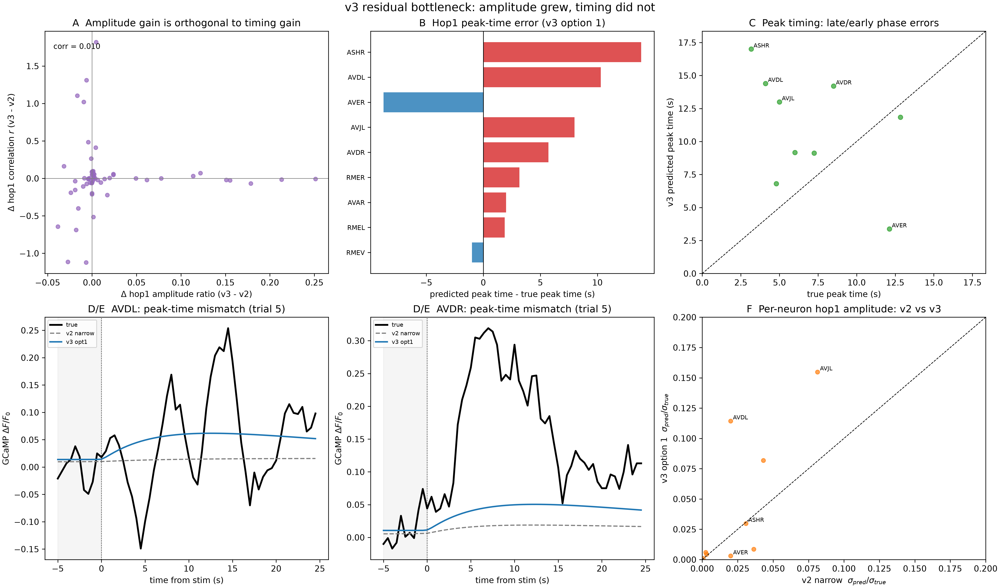

# C. elegans Whole-Brain GCaMP Modeling Report

> **Status**: research generative model, not a sign-off model.  
> **Code**: `glowing-journey`, base `e26d99c`; `39201be` added the per-neuron/per-edge features and this report; this commit adds the Toyoshima NaCl loader and test-evaluation guard.  
> **Result sources**: `/Users/yanlu/Documents/glowing-journey_runs/{ab,v3,v4,v5}_2026-11-19/`.  
> **Last compiled**: 2026-11-19.

---

## 0. Summary

This project predicts whole-brain GCaMP ΔF/F0 in *C. elegans* from optogenetic stimulation and the connectome, using a biophysical membrane / calcium / GCaMP model. Evaluation is strictly post-stimulus (`t >= 10` frames / 5 s) and splits neurons by connectome distance into direct-stimulated, 1-hop, 2-hop, and unconnected groups. The test set contains 11 unseen worms and 329 trials.

The current best combined model is **v5 edge e2**:

- `post_inlier_R² = 0.1202`
- `hop1_R² = 0.0736`
- `hop1_r = 0.291`
- `stim_r = 0.388`
- `unconnected_r = 0.316`
- `RMSE = 0.1744`

Relative to v3 ungated option 1+2:

- `post_inlier_R²` 0.1114 → **0.1202**
- `hop1_R²` 0.0494 → **0.0736** (+49%)
- `RMSE` 0.1753 → **0.1744**
- `stim_r` 0.413 → 0.388 (small cost)
- `unconnected_r` 0.319 → 0.316 (essentially unchanged)

Open problems: 1-hop amplitude is still only about **0.26×** of the true amplitude; peak-time errors remain for `AVDL`, `ASHR`, `AVER`, and others; training-seed variance and the validation/test domain gap remain major risks.

---

## 1. Method

### 1.1 Task

Given:

- 300 canonical neurons;
- a 60-frame GCaMP trial (`dt = 0.5 s`; the first 10 frames are the 5 s pre-stimulus window, the last 50 frames are the 25 s post-stimulus window);
- optogenetic input `ExternalInput` (direct targets and timing),

predict the post-stimulus GCaMP trajectory of the same trial. Evaluate generalization on direct-stimulated, 1-hop, 2-hop, and unconnected neurons.

### 1.2 Biophysical model

Membrane voltage:

$$
C_i \frac{dV_i}{dt}
= I_{\text{stim},i} + I_{\text{gap},i} + I_{\text{chem},i} + I_{\text{leak},i}
$$

Leak:

$$
I_{\text{leak},i} = G_i (E_i - V_i)
$$

Gap junction:

$$
I_{\text{gap},i} = \sum_j g^{\text{gap}}_{ij} (V_j - V_i)
$$

Chemical synapse (Wicks 1996 form, summed over edges):

$$
I_{\text{chem},i}
= \sum_{j \to i} \bar g_{ji} w_{ji}\,
\sigma\!\left(\frac{V_j - V^{\text{rest}}_j}{V^{\text{slope}}_j}\right)
\left(E^{\text{rev}}_{ji} - V_i\right)
$$

Calcium and nuclear GCaMP6s:

$$
\frac{d[\mathrm{Ca}]_i}{dt}
= \frac{[\mathrm{Ca}]_{\text{rest}} - [\mathrm{Ca}]_i}{\tau_{\mathrm{Ca},i}}
+ \alpha_{\mathrm{Ca}}\,
\sigma\!\left(\frac{V_i - V_{\mathrm{th}}}{V_{\mathrm{slope,Ca}}}\right)
$$

$$
\frac{db_i}{dt}
= k_{\mathrm{on}} [\mathrm{Ca}]_i^n (1-b_i) - k_{\mathrm{off},i} b_i
$$

$$
\hat y_i = \text{gain}_i (b_i - b_{0,i}) + \text{offset}_i
$$

The model uses 300 neurons, 2167 gap junctions, and 3638 chemical synapses. The 8770 neuropeptide / monoamine extrasynaptic links are disabled by default.

Two experimental sources are supported:

- **Randi optogenetic whole-brain GCaMP** (primary benchmark in this report).
- **Toyoshima et al. (2022) NaCl whole-brain GCaMP** (`--source toyoshima`; a sensory rather than optogenetic perturbation; see §2.5).

### 1.3 Model variants

| Variant | Key change | Purpose |
|---|---|---|
| `old_v2_narrow_vae` | Old VAE; hard `0.0165 nS` cap on `g_max/g_syn`; no pre-stim encoder | Historical baseline |
| `c302_bio_v3` | Pure biophysical `RecurrentNematode` + AutoDiagonalNormal | Control without the VAE encoder |
| `vae_opt1_v3` | Removed tanh wall; wide `g_max/g_syn`; per-edge NT-centered `E_rev`; bounded `v_th_ca_logit` | Independent effect of option 1 |
| `vae_opt2_ungated_v3` | Option 1 + **strictly causal pre-stim encoder** (reads only `y[:, :10]`) | Option 2; slow-wave initial state |
| `vae_opt2_gated_v3` | Option 2 + `direct_hop1` gate during training and inference | Earlier gate hypothesis |
| `v4_opt2_e8` | v3 + **per-neuron `tau_ca/k_off`**, warm-started | Neuron-level calcium-kinetics heterogeneity |
| `v5_edge_e2` | v4 + **per-edge `V_rest/V_slope` residuals**, 2 edge-only epochs | Per-edge release-threshold heterogeneity |
| optional actuator | `--stim-actuator`, `--per-neuron-stim-gain` | First-order opsin rise/decay and constrained target gain |

### 1.4 Training and inference

- Variational inference: Pyro `SVI` + `Trace_ELBO`; `ClippedAdam`; mini-batch 128; `substeps=2`; `dt_obs=0.5 s`.
- v3: 20–25 epochs from scratch; v4/v5 warm-start from the previous checkpoint for 8 / 6 epochs.
- v5: the first 2 epochs train only the per-edge residuals with all other parameters frozen. Unfreezing later degrades the result, so the best point is epoch 2.
- Inference: fixed seed, 16 posterior samples; open-loop evaluation uses the guide EMA posterior and never reads future observations.
- `v_th_ca_logit` is always mapped through a sigmoid into `(-60, -15) mV`, avoiding the Pyro `AffineTransform.codomain` out-of-bounds failure.

### 1.5 Evaluation protocol

All main-table test trials are the **11 unseen worms / 329 trials**.

- `post_inlier_R²`: R² on post-stimulus observations with `|y| <= 3`.
- `post_r`: Pearson `r` in the post-stimulus window.
- `stim_r`: `r` on directly stimulated neurons.
- `hop1_r` / `hop2_r` / `unconnected_r`: `r` by connectome distance.
- `hop1_R²`: R² on 1-hop observations.
- `hop1 amp`: `σ_pred / σ_true`, measuring 1-hop amplitude attenuation; target is 1.0.

---

## 2. Data

### 2.1 Source and scale

- Raw data: `~/Google Drive/マイドライブ/exported_data` (Randi et al. whole-brain GCaMP optogenetics).
- 110 recordings, 3197 trials.
- Each trial: 60 frames × 300 neurons, `dt = 0.5 s`; 10 pre-stimulus frames and 50 post-stimulus frames.
- Preprocessing: despiking, detrending, ΔF/F0 normalization; v3 additionally applies causal artifact filtering and smooth saturation.

### 2.2 Split

Grouped by **recording (worm)** so no worm appears in both train and test:

| Subset | Recordings | Trials |
|---|---:|---:|
| train | 99 | 2868 |
| test | 11 | 329 |
| test valid observations | — | 1,457,340 |

Test recording IDs:

```
4, 10, 12, 33, 48, 67, 71, 81, 82, 87, 99
```

### 2.3 Artifact handling (v3)

- `max_pre_dev = 2.0`: flag neuron-trials whose pre-stimulus deviation is too large.
- Masked **187 / 216,068 = 0.087%** of neuron-trials, including the known `rec=82, trial=2172, neu=22` and `rec=87, trial=2351, neu=229`.
- The pre-stim encoder applies strict causal rejection for `max|y_pre| > 2.0` and smooth saturation `0.8 * tanh(y / 0.8)`.
- This cleanup changed the gate conclusion: after cleanup, **ungated option 2** outperforms the `direct_hop1` gate on every metric.

### 2.4 Cache files

Derived caches live under `glowing-journey_runs/` and are not copied into this report:

- `v3_2026-11-19/cache/randi_trials_v3_f32.npz` (59 MB)
- `v3_2026-11-19/cache/randi_trials_v3_f16.npz` (35 MB; used for training)
- `v3_2026-11-19/cache/randi_trials_v3_compact.pkl` (18 MB)
- Earlier v2 caches under `ab_2026-11-19/cache/`

This report keeps only lightweight split/parameter/negative-control JSON files and figures. Raw data and full caches are not committed to git.

### 2.5 Toyoshima et al. NaCl dataset (second experiment)

Local source: `/Users/yanlu/Google Drive/マイドライブ/cleandata_smoothened2`.

| Property | Value |
|---|---:|
| Timing rows | 24 |
| Complete `ratio`/`uniqNames` recordings | 21 |
| Missing ratio files | samples 2, 12, 13 |
| Frames per recording | 6000 |
| Native frame rate | 3.69–5.72 Hz |
| Canonical mapped neurons | 65–151 (mean 127) |
| Total NaCl cycles | 679 |
| Loader | `utils.ToyoshimaLoader` |
| Trial geometry | 10 pre + 50 post frames at 2 Hz (`dt = 0.5 s`) |

NaCl switching is a sensory perturbation, not a targeted optogenetic input. The loader therefore uses an explicit operational target set, defaulting to the chemosensory classes **ASH/AWC/ASE**, expanded to canonical `ASHL/ASHR/AWCL/AWCR/ASEL/ASER`. This is a modeling assumption, not a measured activation map. A one-recording smoke test (sample 1, `180710a`) produced 47 trials from 48 onsets with 78 mapped neurons and a 0.26 observation mask.

`report/data/toyoshima_manifest.json` records these counts. The dataset is not yet benchmarked; importing it does not change the Randi results above.

---

## 3. Results

### 3.1 Main result (fixed seed, 16 samples, 329 test trials)

| Model | post_inlier_R² | post_r | stim_r | hop1_r | hop1_R² | hop1 amp | hop2_r | unconn_r | RMSE |
|---|---:|---:|---:|---:|---:|---:|---:|---:|---:|
| zero baseline | -0.0141 | 0.000 | 0.000 | 0.000 | -0.0414 | 0.000 | 0.000 | 0.000 | 0.1868 |
| old v2 narrow VAE | 0.0464 | 0.230 | 0.385 | 0.157 | -0.0081 | 0.062 | 0.047 | 0.036 | 0.1814 |
| c302_bio_v3 | 0.0439 | 0.221 | 0.390 | 0.020 | -0.0306 | 0.046 | 0.034 | 0.027 | 0.1816 |
| v3 opt1 | 0.0479 | 0.235 | 0.384 | 0.172 | 0.0071 | 0.107 | 0.050 | 0.045 | 0.1812 |
| v3 opt2 ungated | 0.1114 | 0.348 | 0.413 | 0.289 | 0.0494 | 0.271 | 0.310 | 0.319 | 0.1753 |
| v3 opt2 gated | 0.0907 | 0.335 | 0.369 | 0.155 | -0.0105 | 0.080 | 0.305 | 0.312 | 0.1772 |
| v4 opt2 e8 | 0.1162 | 0.347 | 0.408 | 0.293 | 0.0633 | 0.279 | 0.308 | 0.316 | 0.1748 |
| **v5 edge e2** | **0.1202** | 0.347 | 0.388 | 0.291 | **0.0736** | 0.261 | 0.310 | 0.316 | **0.1744** |


### 3.2 Independent gain from option 1

From `old_v2_narrow_vae` to `vae_opt1_v3` (pure open-loop, no pre-stim):

- hop1 amplitude ratio: 0.062 → **0.107**
- hop1_r: 0.157 → **0.172**
- hop1_R²: -0.0081 → **+0.0071** (first positive strict cross-animal value)
- `post_inlier_R²`: 0.0464 → 0.0479

Parameter-level changes:

- `g_max` max 0.080 nS; `g_syn` max 0.135 nS;
- 30% of gap junctions exceed the old 0.0165 nS wall while the median stays calm (0.012 nS);
- GABA `E_rev` median -76.5 mV, no longer pinned to the -65 mV floor;
- `v_th_ca = -35.0 mV`, `tau_ca = 7.57 s`, `k_off = 0.0253 s⁻¹`.

### 3.3 Independent gain from option 2

From opt1 to `vae_opt2_ungated_v3` (strictly causal `y[:, :10]`, zero future leakage):

- `post_inlier_R²`: 0.0479 → **0.1114** (2.33×)
- `post_r`: 0.235 → **0.348**
- `RMSE`: 0.1812 → **0.1753**
- `hop1_r`: 0.172 → **0.289**
- `hop1_R²`: 0.0071 → **0.0494**
- `unconnected_r`: 0.045 → **0.319**

After artifact cleanup, ungated opt2 beats the `direct_hop1` gate on every metric: `stim_r` 0.413 vs 0.369 and `hop1_r` 0.289 vs 0.155. **The gate is not the current default.**

### 3.4 Why c302_bio has high stim_r but low hop1

`c302_bio_v3` reaches `stim_r=0.390` but only `hop1_r=0.020`:

- `v_th_ca = -22.6 mV` is inside the physiological range, but `v_slope_ca` is squeezed to **1.72 mV**, close to a hard step.
- `g_max` max is only 0.0177 nS and `g_syn` max is 0.0243 nS, so strong and weak edges remain nearly indistinguishable.
- The VAE keeps a smooth `v_slope_ca ≈ 8.9 mV` and amplifies key edges to 0.08–0.135 nS.

Thus strong direct responses in c302_bio do not translate into 1-hop subthreshold depolarization.

### 3.5 v4: per-neuron calcium kinetics

- `tau_ca` and `k_off` become per-neuron `(300,)` parameters, warm-started from v3 scalars.
- opt1: hop1_R² 0.0071 → **0.0112**, hop1 amp 0.107 → **0.120**.
- opt2: hop1_R² 0.0494 → **0.0633**, hop1 amp 0.271 → **0.279**.
- Learned heterogeneity remains narrow: opt1 `tau_ca = 7.54 ± 0.16 s`; opt2 `8.57 ± 0.36 s`.
- Peak-time errors do not improve: opt1 `AVDL +10.4 s`, `ASHR +13.7 s`; opt2 mean absolute peak error 5.90 → 6.09 s.

Conclusion: per-neuron calcium kinetics improves amplitude/correlation, but is not the phase-error fix.

### 3.6 v5: per-edge release residuals

Warm-started from `v4_opt2_e8`, adding zero-initialized per-edge residuals on top of per-neuron `V_rest/V_slope`; only the residuals are trained for the first 2 epochs.

- `v5 edge e2`: `hop1_R² = 0.0736` (v4 0.0633, +16%), `post_inlier_R² = 0.1202`, `RMSE = 0.1744`.
- Cost: `stim_r = 0.388` (v4 0.408); `hop1 amp = 0.261` (v4 0.279).
- Learned residuals are small: `v_rest_edge` std 3.4 mV; `v_slope` factor 0.998 ± 0.0069.
- Phase only partially improves: `AVER -9.75 → -6.38 s`, `AVDR -2.7 → -1.8 s`; `ASHR` worsens from +2.7 to +4.5 s.
- Continuing edge-only training (e2→e4/e6) drops `hop1_R²` to 0.0575–0.0581; **e2 must be early-stopped**.

### 3.7 1-hop amplitude and dynamics diagnostics


- Largest amplitude gains: `OLLL→OLLR` 0.050→0.301, `VB2→VB1` 0.012→0.226, `AVJR→AVDL` 0.022→0.200, `AWBR→AWBL` 0.025→0.180.
- Their correlations barely change; across 56 hop1 pairs, `corr(Δ amplitude ratio, Δr) = 0.010`. **Amplitude gain and phase gain are orthogonal.**
- The v5 hop1 amplitude ratio is 0.261, still about 1/4 of the truth; 3–4× remains to reach 1.0.



- v3 opt1: `ASHR +13.8 s`, `AVDL +10.3 s`, `AVJL +8.0 s`, `AVDR +5.7 s`; `AVER -8.75 s`.
- These errors cannot be explained by a single global `tau_ca`; per-neuron calcium kinetics and per-edge thresholds only partially improve them.
- The remaining first-order explanation is membrane-voltage integration or network conduction delay, not local GCaMP kinetics.

### 3.8 Negative results and limitations

1. **The gate conclusion has been withdrawn**: after v3 artifact cleanup, ungated option 2 beats the `direct_hop1` gate; the current default has no gate.
2. **Training-seed variance is large**: controlled w2 seeds 42/43 gave test hop1_r -0.063/-0.060 (2-sample training logs), while a single historical run gave +0.141. Same-pool validation (~0.28) did not predict unseen-worm test. Single-seed numbers are not conclusive.
3. **Per-neuron C/G does not solve the problem**: on the full test, fast C/G intervention reduces hop1_r from 0.190 to 0.157 (global) or 0.187 (selected); hop1_R² does not improve. The 16-trial apparent gain was sampling noise.
4. **Edge-only continuation degrades**: after v5 e2, hop1_R² drops from 0.0736 to 0.0575–0.0581; do not continue edge-only.
5. **Amplitude remains low**: v5 hop1 amp 0.261; target is 1.0.
6. **Phase is not closed**: `ASHR` and others still show >5 s peak-time errors.
7. **Model positioning**: research model, not sign-off; do not generate formal Liberty or use it for tape-out sign-off.

### 3.9 Parameter audit

| Parameter | v3 opt1 | v3 opt2 ungated | c302_bio v3 | v4 opt2 e8 |
|---|---:|---:|---:|---:|
| `v_th_ca` | -35.0 mV | -33.4 mV | -22.6 mV | -33.3 mV |
| `v_slope_ca` | 8.92 mV | 8.34 mV | **1.72 mV** | 8.33 mV |
| `tau_ca` | 7.57 s | 8.77 s | 10.68 s | 8.57 ± 0.36 s |
| `k_off` | 0.0253 s⁻¹ | 0.0161 s⁻¹ | 0.0200 s⁻¹ | 0.0174 ± 0.0012 s⁻¹ |
| `g_max` max | 0.0796 nS | 0.0806 nS | 0.0177 nS | 0.0824 nS |
| `g_syn` max | 0.135 nS | 0.135 nS | 0.0243 nS | 0.135 nS |
| GABA `E_rev` median | -76.5 mV | -74.6 mV | -75.5 mV | — |
| `g_max > 0.0165` | 4.6% | 5.8% | 0.06% | — |
| `g_syn > 0.0165` | 30.0% | 39.4% | 15.2% | — |

v5 edge residuals (e2):

- `v_rest_edge_delta`: mean +0.9 mV, std 3.4 mV, range [-17.2, +15.8] mV
- `v_slope` factor: 0.998 ± 0.0069, range [0.972, 1.022]

### 3.10 Statistical and causal caveats (review findings)

These are not fixed by the current report; they are constraints on how the numbers above may be interpreted.

1. **The test set is not locked.** v3/v4/v5 checkpoints and epochs were inspected against the same 11-recording test set, so the v5 result is **exploratory**, not a locked final benchmark. The 329-trial set should be treated as a historical benchmark. `utils.nested_grouped_splits` now provides recording-grouped outer CV with grouped validation inside each train fold; it is a protocol helper, not a completed nested-CV study.
2. **`--val-fraction=0` previously made `val_ds = test_ds`.** The training script now avoids this: with `val_fraction=0`, `val_ds=None`; test is evaluated only at the final save by default (`--eval-test-each-save` opt-in). The historical v3/v4/v5 runs predate this guard.
3. **Preprocessing causality is now opt-in, not retrospective.** `preprocess_gcamp_recording(..., causal=True)` uses past-only Hampel/baseline/normalization and has a pre-stim invariance test. The historical v3/v4/v5 results used the old bidirectional/whole-recording path (`--causal-preprocess` is off by default for backward compatibility), so the old results must not be described as strictly causal forecasting.
4. **The guide still uses a batch-mean global posterior.** `Encoder.forward` averages trials in a minibatch to produce global connectome/neuron posterior loc/scale, then an EMA is used at inference. This is an engineering approximation to `p(θ | Y_train)`, not a hierarchical global/local variational posterior. A proper worm-level latent hierarchy remains future work.
5. **Gap-junction symmetry is fixed in the current code.** Electrical pairs are deduplicated, and `GeneralSynapse` symmetrizes its conductance matrix; a KCL/current-conservation test is included. Historical v3/v4/v5 results predate this fix and used directed currents; they should not be used to compare gap-junction topology effects.
6. **The optogenetic actuator is now optional.** `--stim-actuator` adds a first-order rise/decay state; `--per-neuron-stim-gain` adds constrained per-target gain. The historical results still use the original instantaneous `stim_gain × binary pulse`, so the old latency analysis remains phenomenological.
7. **Global parameter identifiability is not established.** Strong synaptic conductance, high stimulus gain, and a low calcium threshold can compensate. Synthetic parameter recovery, posterior calibration, and connectome-ablation/shuffle controls are required before treating individual parameters as identified.

---

## 4. Reproduction and File Index

### 4.1 Result directories

| Directory | Contents |
|---|---|
| `glowing-journey_runs/ab_2026-11-19/` | First A/B, gate diagnostics, posterior variance, controlled-seed notes |
| `glowing-journey_runs/v3_2026-11-19/` | v3 sequential ablation, 16-sample summary, two diagnostic figures |
| `glowing-journey_runs/v4_kinetics_2026-11-19/` | Per-neuron `tau_ca/k_off`, opt1 e6 / opt2 e8 checkpoints, C/G probe |
| `glowing-journey_runs/v5_edge_2026-11-19/` | Per-edge release, best e2 checkpoint, edge-long negative result |
| `~/Google Drive/マイドライブ/cleandata_smoothened2/` | Toyoshima NaCl second dataset (external, not in git) |

### 4.2 Key checkpoints

- `v3_2026-11-19/vae_opt1_v3/vae_epoch_20.pt`
- `v3_2026-11-19/vae_opt2_ungated_v3/vae_epoch_20.pt`
- `v4_kinetics_2026-11-19/checkpoints/opt1_vae_epoch_6.pt`
- `v4_kinetics_2026-11-19/checkpoints/opt2_vae_epoch_8.pt`
- `v5_edge_2026-11-19/checkpoints/edge_vae_epoch_2.pt` ← current best

### 4.3 Code and tests

- Repository: `/Users/yanlu/Documents/glowing-journey`
- v3 experiments correspond to commit `e26d99c`.
- The v4/v5 per-neuron kinetics, per-edge release, warm-start, and validation-split changes are included in this commit.
- Regression tests: `pytest tests` → **33 passed**.
- `utils.ToyoshimaLoader` and `--source toyoshima` are integrated into `pyro_svi_vae.py`; the loader has a synthetic-fixture test and one-recording smoke test (47 trials from sample 1).
- `--eval-test-each-save` is opt-in; with `val_fraction=0`, test is no longer reused as validation.
- Gap-junction KCL, causal preprocessing invariance, per-neuron stimulus gain, actuator behavior, and nested grouped splits have regression tests.
- All Colab sessions are stopped; there are no active sessions.

### 4.4 Data

Raw Randi data and full caches are not committed to git. Set:

```bash
export RANDI_DATA_DIR="/path/to/exported_data"
```

or use `glowing-journey_runs/.../cache/randi_trials_v3_f16.npz` directly.

---

## 5. Conclusions and Next Steps

### Conclusions

1. Option 1 (removing the tanh wall with sane `e_rev/g_max` scales) has a small, reproducible independent gain: hop1 amplitude 0.062→0.107 and hop1_R² turns positive for the first time.
2. Option 2 (strictly causal pre-stim encoder) is the largest single gain: post_inlier_R² 0.0479→0.1114, and after artifact cleanup no gate is needed.
3. Per-neuron calcium kinetics (v4) gives a small hop1 amplitude/R² gain but does not fix peak timing.
4. Per-edge release residuals (v5 e2) push hop1_R² to 0.0736, but must be early-stopped at 2 epochs; further training degrades the result.
5. The current bottleneck is **1-hop amplitude (~0.26×) and peak-time/phase errors in some neurons**, not another saturation wall.

### Recommended next round

- Warm-start from `v5 edge e2` and try **per-edge release time constants / delays**, rather than continuing to tune thresholds.
- Or add a **low-rank extrasynaptic residual** specifically to fill the 1-hop/2-hop amplitude gap.
- Any new scheme must use a fixed split seed, 16 samples, report mean±std over at least three training seeds, and use a worm-level independent validation set. Do not select models with the same-pool random 15% holdout again.
- Before further Randi tuning: lock a historical benchmark; use `--causal-preprocess` for any causal claim; keep the symmetric gap-junction fix; and use `--stim-actuator`/`--per-neuron-stim-gain` if latency/gain is interpreted mechanistically.
- Then run the Toyoshima NaCl dataset as a second experiment (`--source toyoshima`) with the same locked evaluation discipline.
